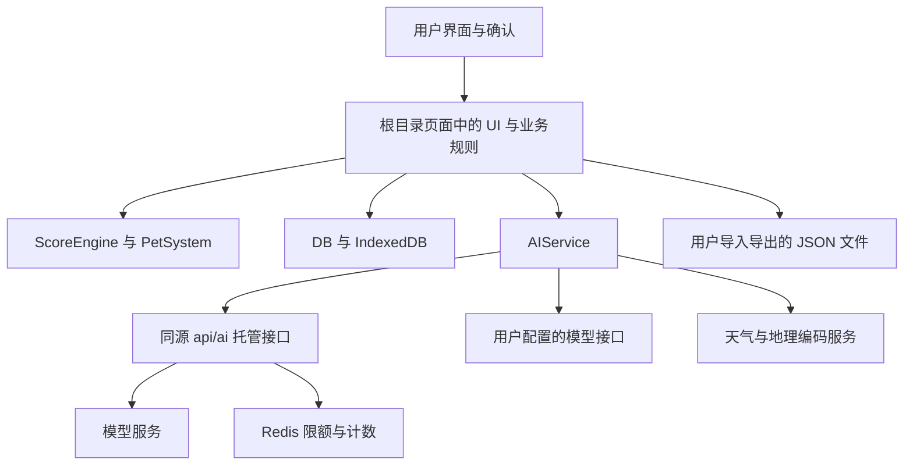

# 当前系统架构

本页描述当前代。3.0 的独立后端与可配置系统另见[完整方案](../V3_CONSENSUS_DRAFT.md)，不要把下图读成未来系统已经建成。

后端实现方向以[决策 0002](../decisions/0002-backend-language.md)为准：优先采用 JavaScript，替代旧共识的 Python 优先偏好；独立后端职责与数据保护要求不变。

图表示代码中的调用关系。`api/ai.js` 在当前线上 Sites 是否已接入，没有充分验证；它不是浏览器业务数据库。

## 模块地图

| 位置或标识 | 职责 | 接手时关注 |
| --- | --- | --- |
| `index.html` 的 HTML 与样式 | 页面、弹窗、宠物场景与响应布局 | 当前没有独立 UI 工程 |
| `CONFIG` 与日期辅助函数 | 规则常量、日期、时间、分类等 | 不把确定性规则搬进提示词 |
| `DB`、`S` 与 `saveTask` 等函数 | 浏览器存储、内存镜像与持久化入口 | 单次写入与整体事务的区别 |
| `ScoreEngine`、`todoScore`、`PetSystem` | 结算、食物、成长与互动 | 保护已有规则，补行为测试 |
| `AIService` 与 `CUSTOM_*_PROMPT` | 自定义模型、托管模型、解析与本地处理 | 与服务端有重复提示词和清洗逻辑 |
| `UI` 的事务与规划方法 | 上下文、确认卡、执行、撤销、建议依据 | 单条和整组范围、确认后再次校验 |
| `App` | 初始化、事件绑定、页面自测 | 启动可能规范化资料和进行跨日结算 |
| `api/ai.js` | 模型请求、上下文压缩、清洗、限额与统计 | 依赖宿主 `req/res` 和服务端环境变量 |
| `dist/index.html` | 构建生成的静态页面 | `npm run build` 从根源码逐字节生成，不入库，来源记录为 `dist/build-info.json` |
| `.openai/hosting.json` | Sites 项目和静态目录配置 | 配置存在不证明服务端已部署 |

查找实现可以使用编辑器全文搜索上述标识；详细功能定位和盘点时行号见[现状清单](../CURRENT_STATE.md)。本地源码与 GitHub 版本有差异，行号与新增方法不能混用。

## 一次事务的流程

用户表达或表单输入，进入识别与整理；程序校验结构、日期和目标；界面展示待执行内容；用户确认后程序执行写入，记录操作结果，并按条件支持撤销。规划只提出建议，不直接改变数据。

现有导入与部分批量操作逐条写入，无法保证中途失败时整体恢复。保存封装以请求成功为主要完成信号，事务真正完成与失败传播需一并核对。后续应在合成数据库里做故障注入，不能凭结构图宣称已有完整保证。

## 整理与演进边界

本轮先建立文档和任务。后续按职责拆分必要模块，并让相同的数据对象、校验与规则能够接入独立后端。不要先换一套前端框架，也不要新建大量空的后端目录伪装进度。

继续阅读：[数据说明](DATA.md)、[AI 与动作接口](AI.md)、[开发入口](../development/README.md)、[设计决策](../decisions/README.md)。
