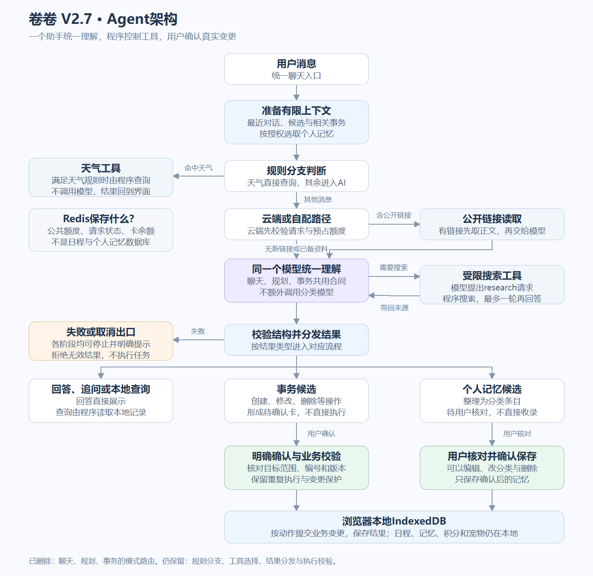

# 技术问答：卷卷V2.7的Agent架构，现在还有路由吗？

问题来自展于2026年11月17日的提问：“现在agent架构是什么呀，现在好像没有路由了？还有吗？”

当前架构是单助手、统一模型理解，加上程序控制的工具调用与事务执行。已删除把用户消息预先分给聊天、规划、事务的模式路由，也没有额外调用一个分类模型；按能力、请求来源和结果类型进行的程序分流仍存在。

本文说明已实现的V2.7，不把未来Next.js迁移、账户后端、多Agent协作或主动思考当作当前能力。代码核对基准为[77ed2c0](https://github.com/jinzhan857-sketch/juanjuan-to-do-list/tree/77ed2c0788b3a6d49528110176c6ad813a955471)，云端初次正式发布为582aac4；后续跨日列表显示修正不改变本文的Agent处理流程。

## 架构图

[查看或下载SVG原图](assets/v27-agent-flow.svg)。图中箭头表示当前一次用户请求的主要处理关系，错误分支为各阶段共用出口；不是后台持续运行或无限循环。

## 1．已经删除什么，仍保留什么？

| 所说的“路由” | 当前情况 | 实现含义 |
| --- | --- | --- |
| 用户选择聊天、规划或事务 | 已删除入口 | 用户无需判断应该切到哪种模式 |
| 先分类，再转交三个独立Agent | 当前没有 | 没有单独的分类模型请求，也没有三个独立Agent互相转交 |
| `agent_role`参数 | 仍保留，当前界面默认`auto` | 是统一理解合同的意图提示；不限制能力或结果类型，不代表三套Agent |
| 天气等规则分支 | 保留 | 命中天气及连续追问条件时由程序查询；包含链接或明确联网请求等情况不直接走该天气分支 |
| 云端与自配API的请求来源选择 | 保留 | 决定请求由Vercel服务端发出，还是从浏览器直连用户配置接口 |
| 搜索、网页读取及结果类型分发 | 保留 | 程序执行受限工具，并按结构化结果决定显示、查询、候选与确认流程 |
| HTTP路径和请求`mode` | 保留 | `/api/ai`及`agent`、评分、取消等是接口用途，不等于用户的聊天模式路由 |

因此，“没有模式路由”成立；“系统完全没有任何分流”不成立。架构名称是对现有实现的描述，不表示已经接入某个Agent框架。

## 2．一次普通消息怎样经过系统？

1. 浏览器保存当前用户消息和请求状态，准备上下文。`agentContext`读取相关日程、待办、当前候选及最近12条对话，按授权选择记忆，并明确资料只是局部选择。
2. `AIService.agent`先处理天气等规则条件，云端图片明确返回暂不支持；其他请求进入云端或自配API路径。
3. 云端检查来源、请求、服务启停和额度。`api/ai.js`向DeepSeek发送统一`assistantPrompt`与有限上下文；自配路径复用同一理解合同，按配置发送。
4. 模型返回完整JSON。普通回答使用`chat`，必要追问使用`clarify`；创建或修改使用`workflow`等候选结果，记忆整理使用`memory_import`。规划本身通常是回答与依据；决定落实后才形成事务候选。
5. 程序验证结构与业务范围，再按结果分发。云端解析成功不等于任务已保存，最终还须经过浏览器中的目标、版本、确认和写入保护。

普通文字回答通常需要一次模型请求。这里没有额外的“先判断用户属于哪个模式”的模型调用。次数说明不包含失败、重试、独立评分及自配图片理解等其他路径。

## 3．搜索和网页阅读是不是Agent自己执行？

模型负责表达需要，程序负责执行允许的工具。

公开链接出现在消息中时，资料模块可以先调用网页读取接口，再把正文作为不可信外部资料放入模型上下文。没有新链接时，也可以按规则选择最近已经读取的资料。

需要搜索时，模型先返回`{"type":"research","query":"搜索词"}`，程序调用资料模块的搜索工具，将结果与来源交回同一个模型，模型再回答或提出候选。当前代码最多进行这一轮搜索后的再回答；第二次仍要求搜索会报错停止，不是持续自主循环。

这条搜索流程通常是两次模型请求加一次搜索工具请求；公开链接阅读通常是网页工具请求加一次模型请求。天气规则分支不调用模型。每个工具调用、模型调用和用户消息不是同一个计数单位，实际用量和额度规则见[AI接口说明](AI.md)及[体验卡说明](../development/V27_EXPERIENCE.md)。

当前用结构化JSON表达搜索意图，由自有代码调度，不应把它描述成已经使用某SDK的原生Function Calling、MCP、Skills系统或通用多步ReAct运行框架。用户自配接口的联网能力还取决于资料模块支持的实际供应商配置；云端当前支持搜索与链接，暂不支持图片。

## 4．模型结果怎样变成真实操作？

| 模型结果 | 程序处理 | 是否直接改变业务资料 |
| --- | --- | --- |
| `chat`、`clarify` | 展示回答或必要问题 | 不改变日程、待办或记忆；聊天消息本身会保存 |
| `query` | 校验日期、范围与条件，再读取本地事务库，展示实际匹配结果 | 只读，模型没有直接查询整个数据库的连接 |
| `workflow`及候选结果 | 核对动作、目标、候选编号、版本与范围，形成待确认卡；明确确认后再执行 | 生成候选不等于执行任务，确认后才提交相应业务变更 |
| `memory_import` | 生成记忆候选，进入核对界面，允许编辑、改分类与删除 | 用户确认保存后写入本地记忆 |
| `recommendation` | 展示建议；用户选择采用时转成待确认事务候选 | 建议本身不执行 |
| 错误、取消、超时或无效结构 | 明确提示，保留相应草稿；拒绝无效、过期或迟到结果 | 不以模型文字“已完成”冒充业务成功 |

浏览器内`applyAssistantWorkflow`、`confirmAgentSelection`、`confirmAgentAction`和`executeAgentAction`等入口承担动作校验与执行，最终通过`commitDataChanges`等持久化入口保存相关数据。具体动作按实际支持的范围进行原子提交和撤销，不保证所有任意动作都可无限撤销。

需要特别区分两类写入：记录聊天、保存待核对卡片是交互状态保存；真正创建日程、修改待办或收录个人记忆是业务变更。前者发生，不代表后者已发生。

## 5．状态与记忆放在哪里？

日程、待办、聊天、个人记忆、积分和宠物仍主要保存在当前浏览器的IndexedDB。Vercel提供云端模型和资料工具接口，Redis维护额度、请求状态与设备体验卡余额；它们不是卷卷日程与个人记忆的云端同步库。

模型只收到本次请求选取的有限上下文，不能直接读取任意本地数据。个人记忆当前采用分类、规则和长度预算选取，基础信息优先，没有语义检索或向量数据库。记忆开关影响后续请求是否提供相关资料，不表示模型自动遗忘已经发出请求中的内容。

目前没有账户系统、跨设备业务同步、后台常驻思考或持续自主执行。刷新页面不会使已保存的本地资料自动消失，关闭Vercel或Upstash管理后台标签也不会停止已经部署的服务；关闭卷卷网页则不等于后台Agent仍在替用户持续执行任务。

## 6．为什么仍然可以叫Agent？

它不只是把用户消息转发给模型：还会准备事务上下文，让模型提出搜索或操作需求，由程序调用工具、校验结果、展示候选，并在确认后完成真实任务和反馈。

但当前适合称为受控的单Agent应用。它的工具种类、步骤、写入权限和停止条件由程序固定，不是多Agent系统，也不是可以自由执行代码、任意使用外部工具的通用自主Agent。是否增加后续运行能力，应在原任务中按具体收益与验收确认。

## 代码定位与维护

| 位置 | 核对内容 |
| --- | --- |
| [index.html：AIService.agent](https://github.com/jinzhan857-sketch/juanjuan-to-do-list/blob/77ed2c0788b3a6d49528110176c6ad813a955471/index.html#L2163) | 天气规则、云端与自配入口、资料与模型请求 |
| [agentContext](https://github.com/jinzhan857-sketch/juanjuan-to-do-list/blob/77ed2c0788b3a6d49528110176c6ad813a955471/index.html#L3344)、[planningMemoryItems](https://github.com/jinzhan857-sketch/juanjuan-to-do-list/blob/77ed2c0788b3a6d49528110176c6ad813a955471/index.html#L3253) | 有限上下文、记忆授权及资料选取 |
| [sendAgentMessage](https://github.com/jinzhan857-sketch/juanjuan-to-do-list/blob/77ed2c0788b3a6d49528110176c6ad813a955471/index.html#L3603)、[applyAssistantWorkflow](https://github.com/jinzhan857-sketch/juanjuan-to-do-list/blob/77ed2c0788b3a6d49528110176c6ad813a955471/index.html#L2974)、[confirmAgentSelection](https://github.com/jinzhan857-sketch/juanjuan-to-do-list/blob/77ed2c0788b3a6d49528110176c6ad813a955471/index.html#L3025) | 返回类型分发、候选保护与明确确认 |
| [executeAgentAction](https://github.com/jinzhan857-sketch/juanjuan-to-do-list/blob/77ed2c0788b3a6d49528110176c6ad813a955471/index.html#L3823)、[commitMemoryImport](https://github.com/jinzhan857-sketch/juanjuan-to-do-list/blob/77ed2c0788b3a6d49528110176c6ad813a955471/index.html#L5107) | 最终业务执行、记忆保存与持久化 |
| [workflow.js：assistantPrompt](../../src/assistant/workflow.js) | 同一理解合同、意图提示、JSON与候选范围校验 |
| [materials.js](../../src/assistant/materials.js) | 搜索、公开链接读取、历史资料与不可信外部文本边界 |
| [api/ai.js](../../api/ai.js) | 云端预占、模型请求、有限搜索再回答、解析及失败反馈 |
| [api/cloud.cjs](../../api/cloud.cjs)、[api/quota.cjs](../../api/quota.cjs)、[api/experience.cjs](../../api/experience.cjs) | 云端请求边界、公共额度及设备累计卡 |

架构变化时维护本文与原图，功能和发布状态仍进入实际Issue、PR及[版本记录](../development/V27_RELEASE.md)，不修改总计划队列。本文以代码核对为依据，不新增真实模型测试或运行功能。
