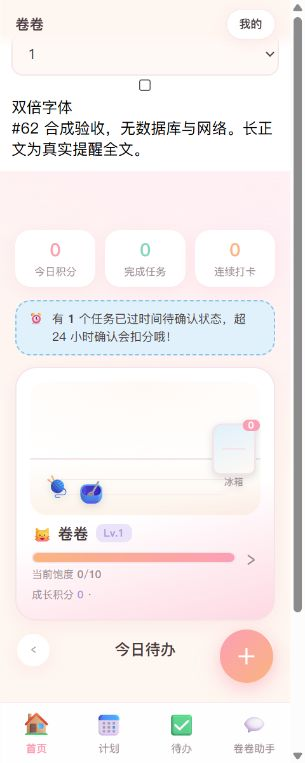
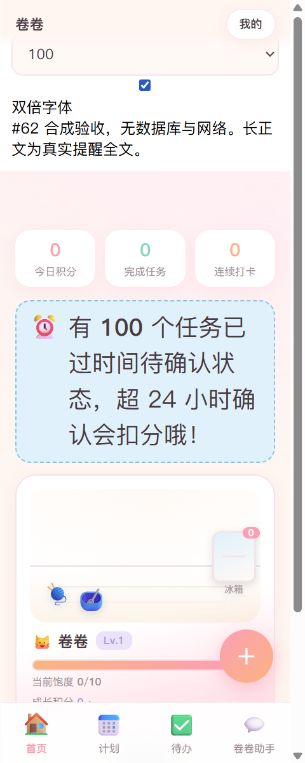

# #62 首页待确认提醒排版

本轮只修首页蓝色待确认提醒。图标与完整正文分别作为布局项，数字仍在正文里加粗，窄屏自然换行。已记录、已复现、已定位、已修复，电脑隔离验收通过，等待独立PR审查合入，未发布。

## 来源和范围

2026年11月15日，Asia/Shanghai。从最新main 60e493ef8fe346dacfabbed252a5058fe98409df创建codex/notice-body-layout。开始时工作区干净，原codex/todo-scope-counts的211dab3成果保留，PR #69仍打开；本轮没有带入#65。应用源码SHA256为F7A3284E28BBB2B2CA008C41F2A9C90662012E13715DDB582DC38A79ECBF00E7，最终受检提交以本报告所在PR的提交及CI为准。

按接手顺序读取产品、架构、数据、AI、开发、测试、发布与确认规则，先启动4173预览并在内置浏览器确认加载。本聊天按展最新要求只做#62。

根因是.notice的横向flex把直接子文本和b数字拆成独立排列项。只增加.notice-icon与.notice-body，正文允许收缩与自然换行。不更改文案、截止筛选、扣分、宠物、存储或其他提醒，不新增兼容处理。

## 验证

| 项目 | 实际结果 |
| --- | --- |
| 原版复现 | 用origin/main源码及纯合成状态，在320像素观察到“有”、数字和后文错位 |
| node --test scripts/notice.test.cjs | 6项通过；原main执行同组回归，1、10、100的3项正文结构失败，0数量及2项业务保护通过 |
| npm run check | 构建、文档链接、26项稳定断言、历史探测及342项Node测试通过，无跳过 |
| 截止与扣分 | 截止之前、恰好截止、截止之后及已结算任务分开验证；24小时之前和恰好24小时无惩罚，超过24小时系数0.5，48小时0.5，恰好168小时0.25，沿用原规则 |
| 数据保护 | 渲染前后S完全一致，测试写入入口遇调用即报错；浏览器不启动App.init或数据库 |
| 浏览器排版 | 320、390、1280像素，各测0、1、10、100条，正常12.5像素及双倍25像素字体，共24组通过 |
| 正文与图标 | 实际UI.renderNotices输出的完整长句，数字留在正文，正文无横向溢出，提醒位于视口内；0条时没有提醒 |
| git diff --check | 通过 |

浏览器通过select和checkbox正常交互改变合成数量及字体，只读DOM核对正文、数字归属和边界，并检查关键截图。测试服务为scripts/notice-browser.cjs，4184来源，CSP connect-src none，无网络与真实模型。原版4185对照只读被忽略的.reports/notice-before.html。24组明细保存在本机.reports/notice-layout-results.json，不含私人数据。

## 截图与待验

正常字体，320像素，1条：

双倍字体，320像素，100条：

截图仅合成状态。真实安卓和iPhone未测，不能用电脑窄屏替代；#61信息栏尚未实施，未来复用正文后仍需回归，不提前勾选该项。114条预期仍是待实施矩阵，不计入342项测试。没有读取私人备份、迁移真实资料、调用真实模型或发布网站。
