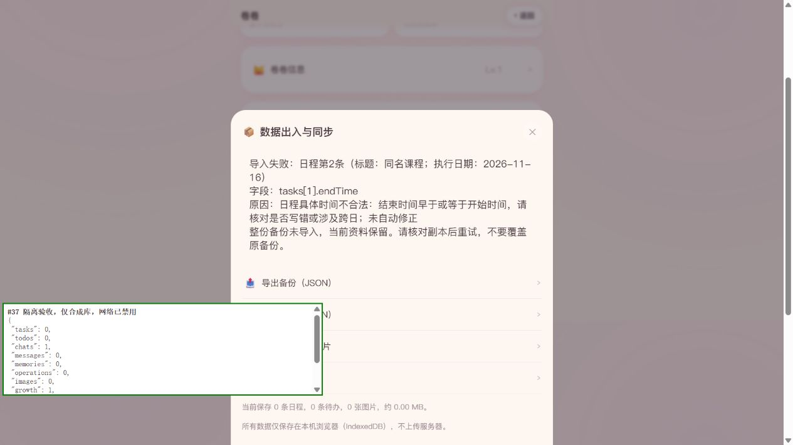

# #64 导入错误定位

2026年11月15日，从最新main 306404e0b0cb82c2b14673f9d9aaeec10bc4242a建立codex/import-error-location。资料分支与原目录接手时均无未提交改动，未覆盖其他聊天成果。PR #67已合入，114条样例仍是待实施预期，本报告只验收#64。

## 问题、定位与实现

已记录、已复现、已定位、已修复，电脑隔离来源验收通过，等待PR审查合入。旧代码使用合成23:30至16:30日程稳定抛出“日程具体时间不合法”，没有字段信息；校验器只生成通用Error，导入入口使用短暂toast。

现有校验保留原接受与拒绝规则，为错误添加字段路径，并在导入窗口持续显示集合、从1开始的记录序号、最多48个字符的标题、合法执行日期及原因。技术路径数组位置从0开始，例如第2条对应tasks[1].endTime。操作快照保留before、after及批量快照内位置。按原校验顺序报告首个错误，修正副本后可以重试。

起止错误明确提示结束早于或等于开始，请核对写错或跨日。不猜测、不过滤、不放宽校验、不增加兼容或迁移逻辑。字段正文使用textContent，不插入备份HTML；不显示备注、图片数据、引用值或完整备份。JSON解析与读取异常不转发解析器可能携带的原文片段。错误只在本机界面显示，没有新增日志或上传。

## 实际验证

Node.js 24.16.0、npm 11.13.0。执行npm ci --ignore-scripts、npm run check、git diff --check。统一检查327项测试及26项稳定断言通过；存储专项134项，其中新增15项，原119项继续通过。

新增覆盖非法日期、逆序及相等起止、开始时间格式、重复与缺少编号、图片、链接、消息引用、操作引用及嵌套快照、宠物字段、修正副本、预览取消、正常导入、JSON及读取错误、HTML标题和身份长度。对错误输入同时核对数据库及内存不变、无覆盖确认、输入框清空可重选，私密哨兵值不出现在提示。

先确认4173内置浏览器正常加载。再用node scripts/storage-samples.cjs生成合成样本，node scripts/storage-ui-browser.cjs启动随机58103来源，专用juanjuan-issue37-synthetic库，CSP禁用外部连接。通过实际文件选择走逆序时间拒绝、修正副本预览、取消、重新选择确认导入。失败和取消前后diskHash与memoryHash分别不变；确认后3条日程、1条待办、1张图、1个会话、1条消息、1条记忆和成长12均恢复。界面截图只含合成资料。

浏览器受检页面SHA256为e0e2eccc6f3705b3fcff0d20ba753e3dc1efbdb55944fa4dc14bdf78c3e5bbc5，之后仅将错误边框改为现有主题变量--red；最终源码SHA256为84dbfc5bbc986bc032187704b6e800931bbbd3bcff1b3c6a98a39a3ed9d3a1a7。最终提交与CI见PR。

未进行真实手机验收，未使用私人备份、发布网站、调用真实模型或迁移真实数据。#37已有成果和其他任务范围不变。下一项按原队列为#65，不按编号重排。
