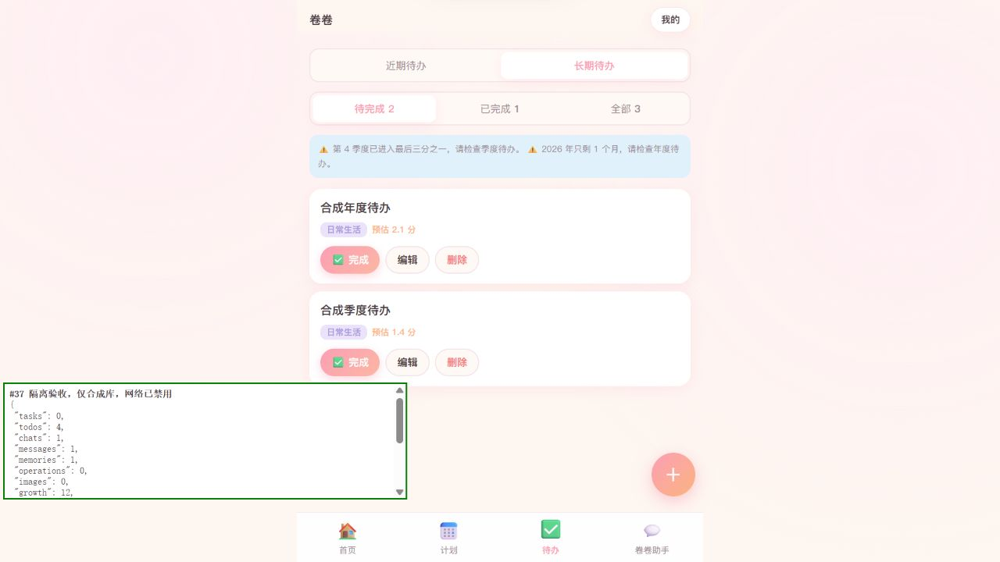

# #65 待办范围计数

2026年11月15日，从已合入PR #68的main 60e493e建立codex/todo-scope-counts。工作区干净，未覆盖其他聊天成果。已记录、已复现、已定位、已修复，电脑隔离来源验收通过，待PR审查合入。未发布。

## 根因和实现

UI.renderTodos先用S.todos全库计算数量，随后才按近期或长期过滤列表。现先按原周期规则得到scoped，三个数量和列表均从scoped派生，再按完成状态筛列表。状态切换不改变三个分类本身的数量，选择范围会改变数量。

没有更改周期归属或已有数据：周、月仍归近期，季度、年仍归长期；缺省与空周期沿用既有归属表达式，不新增兼容规则。未知周期也不增加修补。排序、完成判定、积分与存储均保持原实现。#8整体统计和#66季度提醒另行实施，不在本项扩改。

## 回归结果

Node.js 24.16.0、npm 11.13.0，npm run check全部362项Node测试及26项稳定断言通过，git diff --check通过。新增scripts/todo-scope.test.cjs共26项，加入统一检查。

在原main 60e493e运行这26项全部失败，修改后26项全部通过。24项交叉覆盖近期及长期、空及未完成及已完成及混合、三个状态筛选，逐一核对三个数量、列表ID及重复渲染，不修改原记录、宠物及统计。另覆盖全部现有周期边界与反复切换，实际发布创建、编辑器手选周期后保存、实际完成确认、删除及数据库重开后恢复。

## 直接操作界面

先确认4173加载，再用node scripts/storage-ui-browser.cjs启动49814隔离来源，专用合成库且CSP禁止外部连接。通过正常文件选择导入4条合成待办：近期已完成1条，长期未完成2条及已完成1条。页面SHA256为d7876f8b243652485e76b713797ab6a3b07a0c153db6933cdf3da1c5094a447a。

近期待完成0、已完成1、全部1，待完成列表为空，另两种筛选显示对应记录。长期待完成2、已完成1、全部3，各筛选显示2、1、3条。切换筛选与范围时数据库和内存摘要不变。

通过卡片完成一条长期事项后，数量变为待完成1、已完成2、全部3；删除一条合成已完成后变为1、1、2。刷新页面重开后近期仍为0、1、1，长期为1、1、2，对应列表正确。创建和编辑周期使用实际业务方法在自动测试验证，本轮浏览器未重复手工创建及编辑。截图和回归仅合成资料。

真实手机未测，未读取私人备份明细，未调用模型、迁移真实数据或发布网站。CI与最终头以PR记录为准。下一项按原队列为#62。
