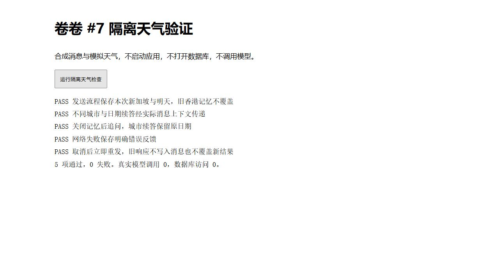
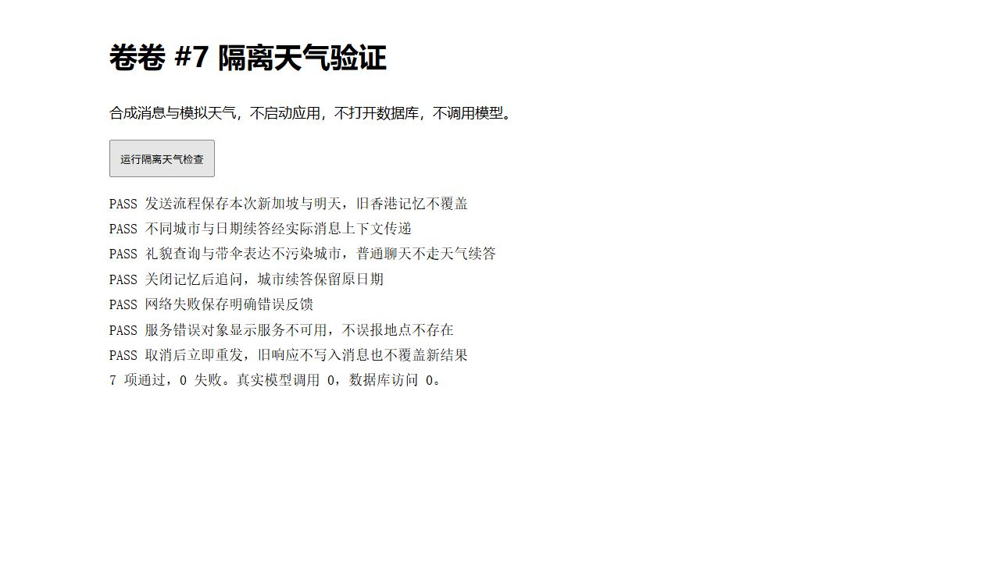

# #7 天气地点优先级交付

2026 年 11 月 15 日，Asia/Shanghai。仅处理[任务 #7](https://github.com/jinzhan857-sketch/juanjuan-to-do-list/issues/7)，交付 PR、最终提交与双平台 CI 链接在任务页维护。初次交付未授权合入或发布，后续复审与合入授权见末节。

## 接手与根因

接手 main 为 7e43de22b9788181fab50e3ba912b306a7b1ebb1，与 origin/main 一致，工作区干净。按 AGENTS.md 和 HANDOFF_ISSUE7.md 读取项目、产品、架构、数据、AI、开发、测试、发布和总计划；核对 #2 至 #6 已关闭、成果已合入，#37 仍 open。没有重做这些任务或改动其他聊天成果。

npm run dev 因 4173 已占用退出，后台内置浏览器复用现有服务并确认卷卷页面加载，没有结束原服务。固定 Node.js 24.16.0、npm 11.13.0，npm ci --ignore-scripts 成功。接手基线 26 项稳定断言、113 项 Node 测试通过。

旧 weatherLocation 把本次输入与记忆拼接，香港关键词先于当前地点解析命中。旧天气路径还在注册 activeAgentController 前提前返回，取消按钮无法中止天气网络；响应数据未完整校验，可能显示 undefined。

## 修改结果

地点按本次明确表达、当前天气对话、已授权且唯一的居住地点记忆依次选择。解析和来源选择分开，不按城市新增例外。原有香港坐标仅保留作解析后的坐标映射。

消息 meta.weather 保存地点与相对日期；当前聊天最近 12 条历史传递这些信息。城市续答保留日期，日期续答保留城市；普通话题结束天气上下文。无地点追问，地点无结果与网络错误分别反馈。地理编码和天气响应检查 HTTP、JSON、坐标与必需数值，缺失数值不生成实况回复。

天气接入既有取消控制器。取消后检查请求及 JSON 完成状态，即便网络忽略 abort 也不返回天气结果；UI 原有请求序号保护阻止旧消息写入，旧请求 finally 不清除新控制器。没有修改模型请求流程或额度规则，#38 保持原范围。

## 可重复验证

| 检查 | 实际结果 |
| --- | --- |
| 原 main 上运行新增城市冲突断言 | 新加坡、北京、上海、广州、Singapore、New York 共 6 项均失败，实际均为香港 |
| node --test scripts/weather.test.cjs | 34 项通过，0 失败、取消或跳过 |
| npm run check | 构建、文档、26 项稳定断言、147 项 Node 测试通过 |
| git diff --check | 通过 |
| 后台原生浏览器，4175 隔离来源 | 5 项通过，0 失败 |
| npm run check:archive | 提交后执行，结果见任务交付记录 |
| Windows 与 Ubuntu PR CI | 最终状态与链接见任务交付记录 |

原始历史脚本 docs/audit/2026-11-14/check-baseline.cjs 及旧失败归档未改。包装脚本只将城市探测预期由香港改为新加坡，三个探测继续执行。原始失败重现日志留在本机 .reports/issue7-before-tests.txt，原基线留在 .reports/issue7-before.json；公开报告仅含合成输入和结果。

离线测试关闭 App.init，使用 VM、合成响应和可控计时器，不调用模型、不读取正式数据库。覆盖同城与跨城市输入、日期前置及无标点表达、无地点、关闭记忆、冲突记忆、地理编码错误、空结果、损坏 JSON、非法坐标、缺少天气数值、网络失败、超时、取消发生于地理编码、预报与 JSON 解析，以及取消后重发。

原生浏览器复验命令为 node scripts/weather-browser.cjs，后台打开 http://127.0.0.1:4175/ 后点击运行。使用实际角色分配、记忆筛选、UI.sendAgentMessage、UI.agentContext 与 UI.cancelAgentMessage，仅替换持久化、布局渲染和网络边界。验证消息元数据保存、换城市及日期、关闭记忆追问、网络反馈与取消后立即重发，5 项全部通过。App.init 关闭，不打开数据库，测试页禁止 DB.init 与 DB.request。

## 真实服务探测与限制

本机 Node fetch 单独访问已有 Open Meteo 服务，不调用模型。地理编码以 Singapore、新加坡、北京为合成测试地点均返回 HTTP 200 与结果。新加坡返回纬度 1.36667、经度 103.8，北京返回纬度 39.9075、经度 116.39723。

预报接口使用合成坐标 1.3、103.8，请求当前温度、体感、天气码、风速，以及三日高低温和降雨概率，10 秒超时，实际为 TimeoutError。因此没有宣称真实天气完整链路成功，也没有把模拟温度当作实况。该服务到达限制已如实记录，不新增代理、备用服务或兼容路径；目标设备实况连通性仍可在单独验收时复核。

本轮应用源码 SHA256 为 6f97e03683a902926b572514428d21e97e96fe523825c185110761d968eb4380。api/ai.js 未修改，SHA256 为 cbd3ed502baec82f87688b01f3bd76b6939b8404d6eeb64dab182dd92d001097。

## 数据与边界

没有导入、清空、迁移或试写真实资料，没有改变宠物与积分算法，没有新增依赖、账户、密钥、权限或兼容处理。没有修改发布工作流，没有调用真实模型，模型调用数为 0。#37 保持独立验收，#3 至 #6 的源码与保护继续保留。PR 保持待审查，任务与总计划记录交付但不把未合入成果写成已上线。

## PR #48 复审与补齐

展随后明确授权认真复审，通过后合入 main，更新 #7 与总计划，不发布，#37 继续独立验收。复审开始时分支为 codex/weather-city-priority，HEAD 3c458f9，工作区干净，PR main 基线仍为 7e43de2，既有双平台 CI 成功。

复审核对完整差异、消息元数据传递、实际角色分配、记忆筛选、取消与过期结果、导入消息的边界，以及测试替身是否可能掩盖问题。发现以下漏测行为，合入前先修复。

| 复现输入或响应 | 初次交付实际行为 | 修复 |
| --- | --- | --- |
| 请帮我查新加坡天气 | 城市解析失败，可能退回上下文北京或记忆香港 | 查询命令按语法移除组合礼貌前缀 |
| 新加坡要不要带伞 | 城市被解析为新加坡要不 | 先完整匹配天气谓语，再分离城市 |
| 天气查询后说讲个笑话或聊聊学习 | 被当作城市续答并发起地理编码 | 成功后只接受明确地点表达或城市续答句式；追问状态可直接补城市 |
| HTTP 200，正文为 error: true | 错误显示为地点不存在 | 服务错误对象直接归为服务不可用 |

首批新增 9 项复审断言在 3c458f9 上为 8 项失败、1 项通过，日志保留在本机 .reports/issue7-review-before.txt。补齐后新增测试共 11 项，天气测试合计 45 项通过；还验证“我在新加坡”可继续上次日期，未知地点追问后可直接改答上海，普通聊天实际进入模拟模型边界且不发天气请求。没有调用真实模型。

最终 npm run check 为 26 项稳定断言和 158 项 Node 测试通过，0 失败或跳过；git diff --check 通过。提交后的归档检查、最终双平台 PR CI 与合入提交以任务页记录为准，不沿用旧 HEAD 的 CI 作为新修改的证据。

后台原生浏览器在 4175 隔离来源复验 7 项通过，包含原 5 项流程、新增礼貌查询与带伞表达、普通聊天路由边界和服务错误对象。真实模型调用与数据库访问均为 0。初次交付的截图与记录保留。

复审后 index.html 的 SHA256 为 c352f4dfdad6dc2706435442423dc1d7c5a2037027150559579b008bc930ed4c。api/ai.js、发布配置、历史探测脚本、#37 与其他任务源码未修改。真实预报服务首次探测超时的限制继续保留，本轮不扩大到网络托管或备用服务建设；不影响本项地点优先级的离线验收，也不据此声称实况已验收。
