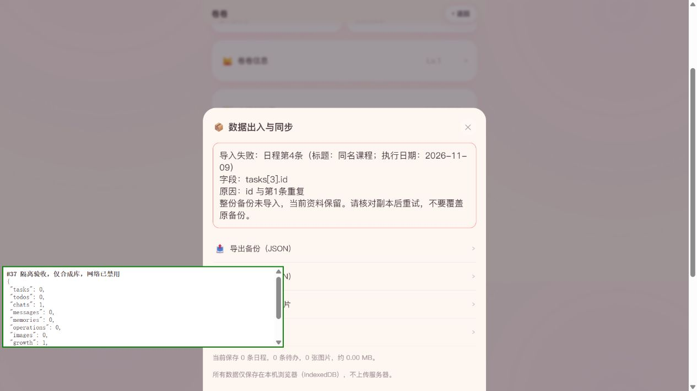

# PR #68 复审

2026年11月15日，按展授权复审，通过后合入，不发布。原头228bc06，main 306404e，工作区干净。核对完整差异、校验顺序、字段路径、操作快照、导入事务及错误渲染。

未发现需要修改功能代码的问题。原校验谓词与整份拒绝保留，新增内容只为错误提供上下文；没有新增兼容、清洗或数据迁移。textContent显示正文，JSON异常不回显解析器片段；没有新增网络或日志。

补充9项回归：六类集合重复编号精确位置，before与after批量快照第二条字段，以及空集合的合法恢复和缺失集合拒绝。每项拒绝均核对数据库及内存不变。当前npm run check共336项Node测试、26项稳定断言通过，存储专项143项；原114条未来样例未计入。

4173确认加载后，在62125随机来源启动当前原样源码，专用合成库，禁止外部连接。直接操作文件选择导入重复编号样本，准确显示第4条、tasks[3].id及与第1条重复，错误前后数据库与内存摘要不变；合法样本进入预览并清除旧错误，取消后摘要仍不变。页面SHA256为84dbfc5bbc986bc032187704b6e800931bbbd3bcff1b3c6a98a39a3ed9d3a1a7。

私人最新备份仅核对文件名和更新时间，复审无需其内容，未读取明细或上传；全部公开证据为合成资料。未测真实手机、未调用真实模型、未迁移真实数据或发布网站。最终头、CI与合入结果见[PR #68](https://github.com/jinzhan857-sketch/juanjuan-to-do-list/pull/68)。
