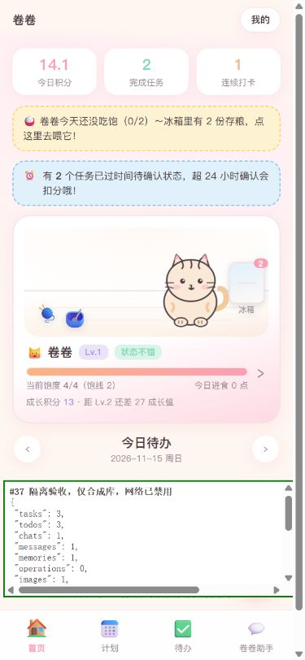
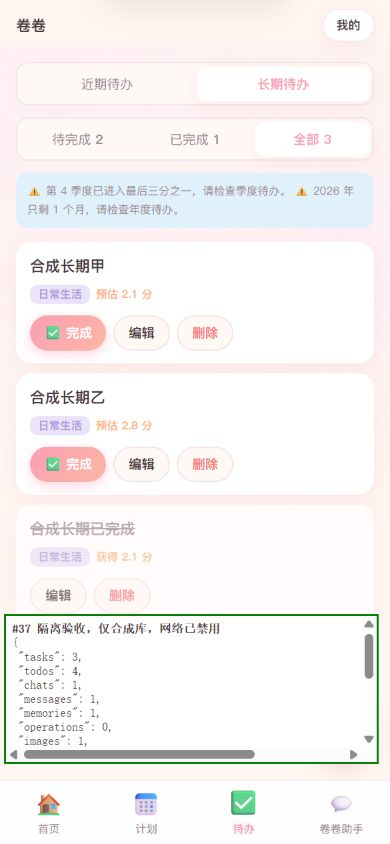

# PR #69 冲突处理与联合复审

2026年11月15日，展授权处理PR #69冲突、保留#62成果，认真复审和联合检查，通过后合入并同步Issue与总计划。未授权发布或实施#66，本轮均未执行。

## 基线、冲突与审查结论

开始时工作区干净，#65分支为211dab3，最新main为e3af20dc5fa559cfe2b1c17740db6f60f37a0c1f，已含PR #70。先确认4173预览HTTP 200及内置浏览器加载，再切回codex/todo-scope-counts，以普通合并整合main。

冲突仅在docs/STATUS.md、docs/development/TESTING.md和package.json。前两份保留双方章节与历史，顶部补充当前联合状态；测试命令保留notice.test.cjs并追加todo-scope.test.cjs，未删任何原检查。index.html自动合并后，对main的差异仍只有原#65的renderTodos取数顺序，#62两条样式、正文结构、11项测试及验收证据完整保留。原#64校验、api/ai.js、发布工作流均未改动。

审查原实现、当前完整差异及26项待办测试，未发现需补应用代码的问题。计数与列表从相同范围派生，状态筛选不改变范围总数；原周期归属、排序、计分和持久化不变，不新增兼容规则。#66季度提醒沿用原实现，未借本轮修正。

## 联合检查

| 检查 | 实际结果 |
| --- | --- |
| npm run check | 构建、文档、历史探测、373项Node测试、26项稳定断言全部通过，无跳过 |
| 范围与提醒专项 | 26项todo-scope与11项notice同时纳入统一入口，存储与导入原回归全部保留 |
| #62成果保护 | 对main核对notice测试、浏览器入口及原复审报告无差异；应用差异只涉及renderTodos |
| git diff --check | 通过，冲突标记已清除 |
| 实际界面联合流程 | 同一来源、同一合成数据完成下述复验，未操作日常浏览器数据 |

整合源码SHA256为1a7a9be2bfd4185e7503e84b99e22c49156b0906cca1cd4baa0141f186040433。最终提交和Windows、Ubuntu检查及合入结果记在PR与Issue，不以原分支362项或main347项通过记录代替本轮联合373项检查。

## 实际界面复验

运行node scripts/storage-samples.cjs，基于其纯合成备份构造4条待办：近期已完成1条，长期未完成2条与已完成1条。错误副本仅将第一条日程结束改为09:00，早于10:00开始。node scripts/storage-ui-browser.cjs使用56967随机本机来源、juanjuan-issue37-synthetic专用库，CSP禁止网络，观察面板只读。

1. 正常文件选择导入错误副本，窗口持续定位日程第1条、合成标题、日期及tasks[0].endTime，整份拒绝；前后磁盘和内存摘要相同。
2. 选择合法副本出现完整预览，取消后磁盘和内存摘要仍相同；再次选择并确认后恢复3条日程、4条待办及原合成附件、记忆等。
3. 首页显示2条待确认任务，图标与完整正文自然布局，数字计算样式为inline，正文没有横向溢出。刷新后仍正常；真实手机不计为通过。
4. 近期三个数量为待完成0、已完成1、全部1；三种筛选列表分别0、1、1条。长期为2、1、3；列表分别2、1、3条。切换筛选和范围后磁盘摘要不变。
5. 完成长期待办甲，长期数量变为1、2、3；删除尚未完成的长期乙，变为0、2、2。刷新重开后长期仍为0、2、2，近期为0、1、1。原创建、编辑周期、重开与持久化回归也在373项测试中通过。

本机.reports/pr69-joint-browser.json保留合成检查结果，样本与明细均不入库。截图只含合成数据。

## 边界与停止条件

本轮无需修改产品行为或追加临时判断。真实安卓和iPhone未测；#62仍保留未来#61信息栏及真实手机综合待验项，不因#65合入而关闭。114条预期不是已通过测试，未计入373项。未读取私人资料、调用真实模型、迁移真实数据、发布或实施#66。关键检查失败时不合入，保留证据。
