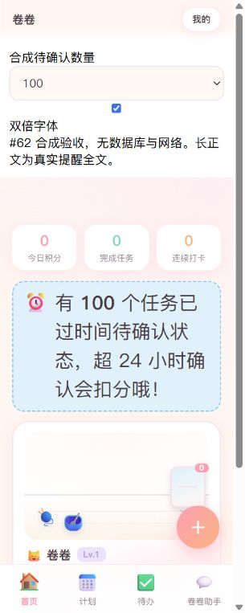

# PR #70 复审记录

2026年11月15日，展授权认真复审、修正问题并在检查通过后合入；不发布、不做#66。

## 结论与改动

基于main 60e493e审查PR原提交8db2a26。工作区开始干净，远端main未变，PR没有已有审查意见或未解决讨论。逐项检查完整差异、原Issue范围、实际CSS与renderNotices、截止和扣分函数、测试及合成浏览器入口，没有发现需改应用代码的问题。

应用差异仍只有两条局部样式和一处正文结构。图标不压缩，正文可收缩，b保留行内排版。其他提醒不使用新增类名，原判定、文案、宠物、存储和计分保持不变，#65的PR #69没有混入。

复审补齐两处验收工具问题：原DOM替身给innerHTML赋值时不清空children，无法准确验证连续渲染；合成验收控件被固定顶部遮挡。现已修正，并在浏览器入口校验App.init禁用标记唯一，防止源码变动后悄悄启动应用。这些只影响测试入口，不改变产品行为。

## 实际验证

先确认4173静态服务HTTP 200，并在内置浏览器确认当前源码正常加载。所有数据测试只用合成状态。

| 检查 | 结果 |
| --- | --- |
| node --test scripts/notice.test.cjs | 11项通过，新增5项边界回归 |
| 重复渲染 | 1、100、10、0、1、0连续切换，始终只有最新数量，清空后没有旧提醒 |
| 已结算状态 | CONFIG.STATUS中的全部状态均排除，缺省和null仍按原规则待确认 |
| 宠物提醒 | 生病、未吃饱、待确认三条共存；喂食动作保留；离开时仍只展示重新领养 |
| 午夜截止 | 全天和晚上时段在截止恰好时不提示，超过1毫秒才计入；精确时间及24小时扣分边界回归保留 |
| 浏览器24组 | 320、390、1280像素；0、1、10、100数量；12.5、25像素字体，全通过 |
| 排版实际值 | 每组核对innerWidth等于请求宽度，正文实际字体正确，数字在行内，正文不横向溢出及不超出容器底部，提醒处于视口内，图标与正文顶部对齐 |
| npm run check | 构建、文档、26项稳定断言、历史探测和347项Node测试通过 |
| git diff --check | 通过 |

实际使用当前源码renderNotices，select与checkbox正常交互，只读DOM测量；浏览器又验证一遍数量连续切换。入口不启动App.init或数据库，CSP禁止网络。24组明细留在被忽略的.reports/pr70-layout-results.json。最终受检提交、云端检查与合入结果补记在PR及Issue评论，不以首次交付的通过记录代替最终检查。

## 剩余边界

真实安卓和iPhone未测，未来#61信息栏尚未实现，需要后续回归。#62仍保留该综合待验项，不因PR合入自动关闭整个Issue。114条未来预期未计入347项测试。

未发布、调用真实模型、读取私人备份、迁移真实资料或实施#66；其他聊天成果保留。
