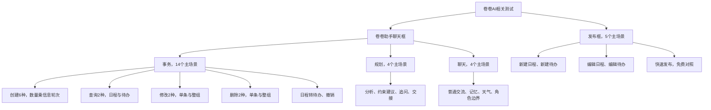

# 测试场景分类与验收指标

这是#104的测试组织方案，不是已执行结果或新增产品承诺。入口按用户实际操作分为发布框与卷卷助手聊天框。原A至T的20类160题是能力覆盖标签，不能当成20种互不重叠的使用场景。题号与原输入保留，首批字段预期见[逐题规格](batch1-field-expectations.md)。

## 分类口径

建议按2个入口、4个处理分支、27个主场景组织：发布框5个，助手事务14个，助手规划4个，助手聊天4个。这是当前测试目录的组织数，不是所有输入组合的总数。一个完整会话按主要目标归一个主场景，日期、图片、轮数等作为附加条件；复杂会话分阶段记录，不能一轮追问和下一轮创建各算一道独立通过题。

事务创建按“单条、独立多条、有限重复”与“信息一次给齐、需要多轮”交叉，形成6种主场景。多轮以用户与系统的消息为准，模型请求次数另算。先给齐后改口属于更正条件，不冒充缺信息补充。

自动选择角色是助手的进入方式，附在实际分支上核对路由，不另重复计场景。托管、自定义、真实模型、本地规则、模拟与回放是执行路径属性，不是新的用户入口。快速发布是相关免费对照，不算AI识别通过。批量独立事项、隔周等在不同路径上的支持情况需查实际响应与合同，不能只因目录列出就宣布已支持；不支持时检查是否正确说明并保留信息，必要时记录待明确需求。

## 27个具体主场景

| 编号 | 主场景 | 本场景额外检查 |
| --- | --- | --- |
| P1 | 发布框新建日程 | 一框一条；定义、备注、执行日期、三档时间精度、标签、基础价值分；识别前后和发布后对照。 |
| P2 | 发布框新建待办 | 一框一条；定义、备注、周/月/季/年周期、标签、基础价值分；不强加执行日期时刻。 |
| P3 | 发布框编辑日程 | 目标ID不变；未改字段保留；手改优先；旧评分与主动重识别分开；保存失败不覆盖原件。 |
| P4 | 发布框编辑待办 | 目标ID、周期、状态及附件保留；不把编辑存成新待办；不重复奖励。 |
| P5 | 快速发布对照 | 零模型请求，按唯一规则表精确评分，来源及版本可追溯，创建不算完成。 |
| T1 | 一次给齐，创建单条 | 日程或待办类型正确，生成一条完整确认内容，确认前零写入。 |
| T2 | 多轮补充，创建单条 | 逐轮缺项与补充来源，已知信息不丢；必要信息齐后才出卡，不重复追问已知字段。 |
| T3 | 一次给齐，创建多条独立事项 | 预期数量N、每条类型和全部字段、事项对应关系；不合并、不漏项、不多造。 |
| T4 | 多轮补充，创建多条独立事项 | 对每条独立记录缺项；回答关联到正确事项；部分信息不足时不擅自发布整批。 |
| T5 | 一次给齐，创建有限重复 | 日期范围、星期、实际展开日期、逐条字段、数量、组身份；不无限展开。 |
| T6 | 多轮补充，创建有限重复 | 补齐范围、星期、时刻等；更正后重算日期与数量；旧版本卡不可执行。 |
| T7 | 查询日程 | 查询范围、状态、关键词、命中ID、漏查和误查、实际总数、排序；业务零修改。 |
| T8 | 查询待办 | 周期/近期长期范围、完成状态、命中ID与总数；不能混入不符条件的待办。 |
| T9 | 修改单条 | 唯一目标ID、完整修改后记录、字段差异白名单；同名其他条与重复组不变。 |
| T10 | 修改整组 | 组ID、范围、实际成员集合和条数；每条修改字段；单条和整组不得混淆。 |
| T11 | 删除单条 | 唯一目标与附件引用、确认取消、确认后删除集合、可恢复证据。 |
| T12 | 删除整组 | 组身份与成员集合精确；同名其他组保留；范围有歧义先追问。 |
| T13 | 日程转待办 | 来源与目标对应；定义、备注、链接图片保留；周期、状态和积分按既有规则核对。 |
| T14 | 撤销已确认操作 | 撤销对象和恢复快照；后续改动冲突拒绝覆盖；重复撤销不重复写入或奖励。 |
| G1 | 分析现有安排 | 冲突区间、负荷、依据ID及计算事实；区分已知事实与推断，零直接修改。 |
| G2 | 在限制内提出建议 | 时间、精力、费用和优先事项约束逐项满足；步骤可执行；建议不等于已创建。 |
| G3 | 资料不足先追问 | 缺哪项资料、是否必要、是否编造空档或偏好；正常追问不算服务失败。 |
| G4 | 建议交给事务执行 | 先建议，再主动选择，再事务确认；逐条字段完整；交接次数、创建数量与来源一致。 |
| C1 | 普通交流和问答 | 回应相关、事实与未知区分、历史指代正确、不冒称实时搜索；业务零修改。 |
| C2 | 使用授权记忆交流 | 开关和相关性；出站实际资料；记忆更正及删除；跨聊天资料边界。 |
| C3 | 天气工具及续答 | 城市来源优先级、查询日期、续答继承、工具结果对应；真实天气和替身分开。 |
| C4 | 角色及能力边界 | 聊天不执行；操作请求转事务；不代收字段、不假装创建；未支持能力明确说明。 |

## 每一条拟创建或修改记录的字段表

每道题的每条事项分别填，不能用一段“日期正确、保存成功”代替。列为“字段、预期、实际模型输出、界面最终值、最终保存值、判定、证据”。修改题同时列原值、期望新值与实际新值；删除题列完整目标快照与预期删除集合。

| 字段 | 怎样写预期 |
| --- | --- |
| 记录类型 | 日程或待办，不用笼统的“事务”代替。 |
| 任务定义 | 写具体文本；注明精确保留、必要词必须保留或允许语义等价。发布框按已确认原文保真规则，助手按核心事务拆字段规则，不能混用。 |
| 备注 | 明确文本或空；地点、材料、教授、限制等逐项核对，不编、不漏、不整段重复。 |
| 执行日期 | 日程写完整年月日；待办写不适用。不要仅写“明天”。 |
| 时间精度 | 全天可做；选时段并写时段名；精确时间并写两端日期和时刻。待办写不适用，信息不足写待补充。 |
| 待办周期 | 待办写周、月、季或年，说明由手选、默认还是原值产生；日程写不适用。 |
| 任务标签 | 写唯一预期或事先列可接受集合及原因；手选必须保留。类别含义不唯一时列待评审，不能事后改标准。 |
| 基础价值分 | 规则评分写精确值及规则版本；AI分写合法范围、精度和判分依据，不随意编标准小数。原值保留题写原值。基础分不等于最终所得积分。 |
| 评分理由与来源 | 明确AI、本地规则、已有记录；理由对应本条定义，不用备注中另一个动作抬分。AI合法数值和语义合理性分别判。 |
| 图片和链接 | 数量、标识、内容哈希、元数据与归属；同次运行检查图片引用未被替换，重开核对持久化内容。 |
| 状态与数量 | 预期事项N条；新建未完成，确认前新增0；确认后按实际选择的事项数核对；创建不发奖励。 |
| 已有对象身份 | 修改/删除写具体ID；组操作写组ID及预期成员集合；新建ID由程序生成，验证唯一性，不预写随机ID。 |

无创建的查询、规划、普通聊天和追问，不硬填虚构任务。改填回复类型、必要内容、依据、查询条件、缺失信息、允许动作集合与预期零写入。

AI分目前只有范围与锚点，没有逐题冻结的唯一分数。[评分说明](../../product/quick-scoring.md)与现有提示词是依据。记录三个独立结果：数值和精度是否合法；理由与任务是否一致；分值高低是否合理。最后一项证据不足标待评审，不能把0至10内任意数值都算质量通过。模糊任务需保留vague/未评分状态，不能为了填表造分。

## 数量、多轮、重复与确认的专用指标

| 情况 | 必须事先写清的指标 |
| --- | --- |
| 单条与独立多条 | 预期条数N、类型分布、输入片段与输出事项的一一对应；逐条全字段；遗漏、多出、误合并、重复条数。 |
| 多轮补充 | 用户输入和系统回复时间线；每轮已知字段、缺失字段、追问项、补充归属、候选版本；信息齐前不得保存。记录用户轮数和真实请求数，不能混为一谈。 |
| 更正与反悔 | 改了什么、没改什么；旧卡是否失效，迟到结果是否覆盖；确认一次只执行最新版本。 |
| 有限重复 | 开始结束日期是否包含边界、星期、间隔、排除日期；展开后的日期集合与数量；组身份；每条时刻、备注、标签、分数与附件。 |
| 多组重复 | 分组数、各组范围及成员集合、组间同名区别、排除与局部修改；不把两组误并成一组。 |
| 批量确认 | 候选数、展示数、主动选择数、预计新增/修改/删除数、实际写入数、跳过重复数；重复确认和中途失败结果；不声称所有批量都必然整体提交，按现有动作合同验收。 |
| 取消与恢复 | 取消前后业务快照；刷新重开状态；事务与附件、积分宠物对照；撤销与取消分开记录。 |

首批Q01是更正后单条创建，I01是一次给齐的有限重复。首批没有覆盖“多轮补齐后创建独立多条”“多轮后多组重复”，不能因20类各选一题就宣布这些场景通过。补题先提输入、字段和预算，不在本次自动扩大。

## 9组共用指标

| 指标组 | 具体核对 |
| --- | --- |
| 内容 | 定义、备注分界、否定、数字编号、换行、重复、长文本；不改意、不丢内容。 |
| 日期时间 | 固定时区时钟、相对日、手选优先、全天/时段/精确、单端补时、跨日、无效与歧义。 |
| 标签与评分 | 标签及可接受集合、合法分值精度、来源理由、原分保留、规则精确值、AI合理性独立评审。 |
| 附件与链接 | 内容、标识、元数据、数量、关联对象、编辑转换及保存重开保留。 |
| 上下文与记忆 | 相关资料、授权、出站正文、同名目标、长背景、当前聊天历史、关记忆和更正。 |
| 确认与数据 | 确认前后、取消、重复确认、旧卡、无关对象、持久化重开、完成状态与积分宠物。 |
| 服务与额度 | 离线、超时、非法返回、取消迟到、草稿保护、设备/网络/全站限额、退款与自动重试次数。 |
| 安全 | 资料恶意指令、越范围写入、外传、HTML、Key、请求地址、来源隔离。 |
| 交互与成本 | 追问是否必要、用户轮数、模型请求数、总耗时、逐次用量、预留/估算/账单、失败及停止原因。 |

逐条报告指标通过/失败/不适用/待评审及分母；另报整题通过/失败/阻塞/未执行。漏项为预期集合减实际集合，多项为实际集合减预期集合。字段比较按预设严格值或语义标准，未填写不算通过。严重误写、数据丢失和泄露单独列，不被平均分掩盖。单次结果不能称稳定；重复频率需新授权和保留所有失败。

判定分四层：模型最终回答，程序清洗后字段，界面待确认内容，最终数据库状态。只要某层有实质错误就留下该层失败，即便下一层规则修正，也不能倒过来称模型通过。没有真实请求的题标无模型结果。接口诊断和回放不能代替用户入口完整验收。
