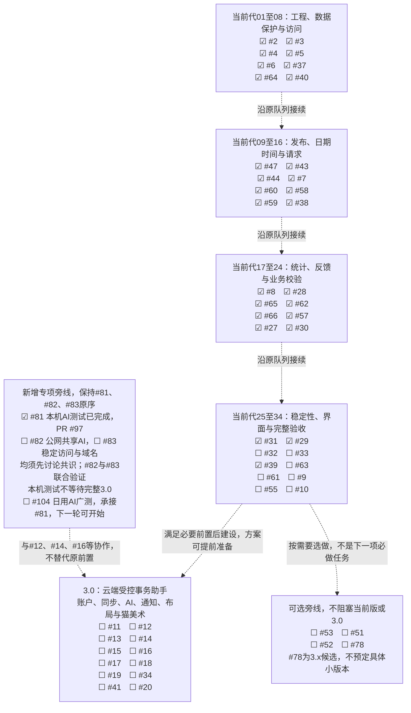
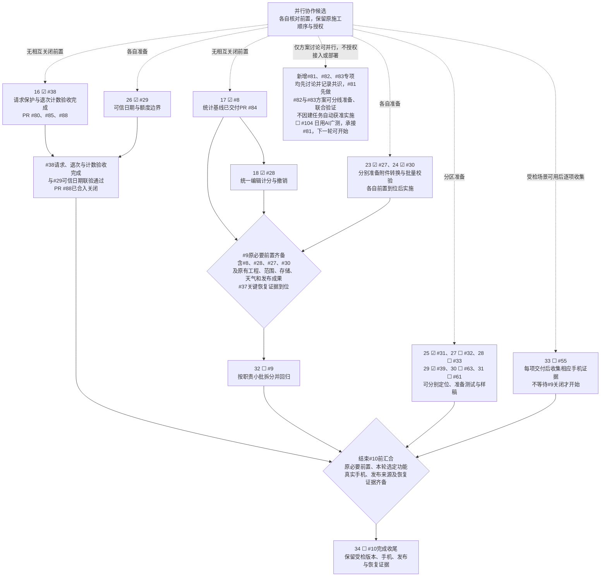
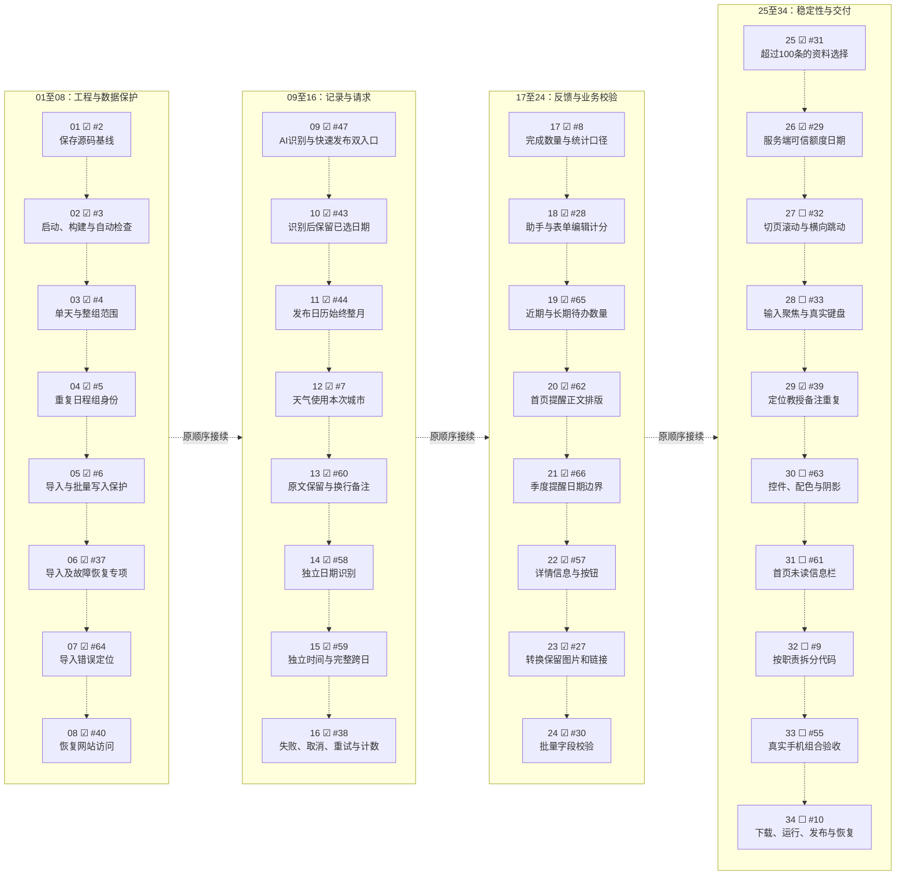
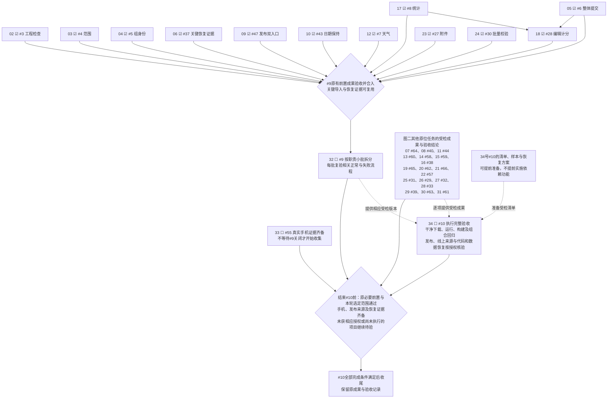
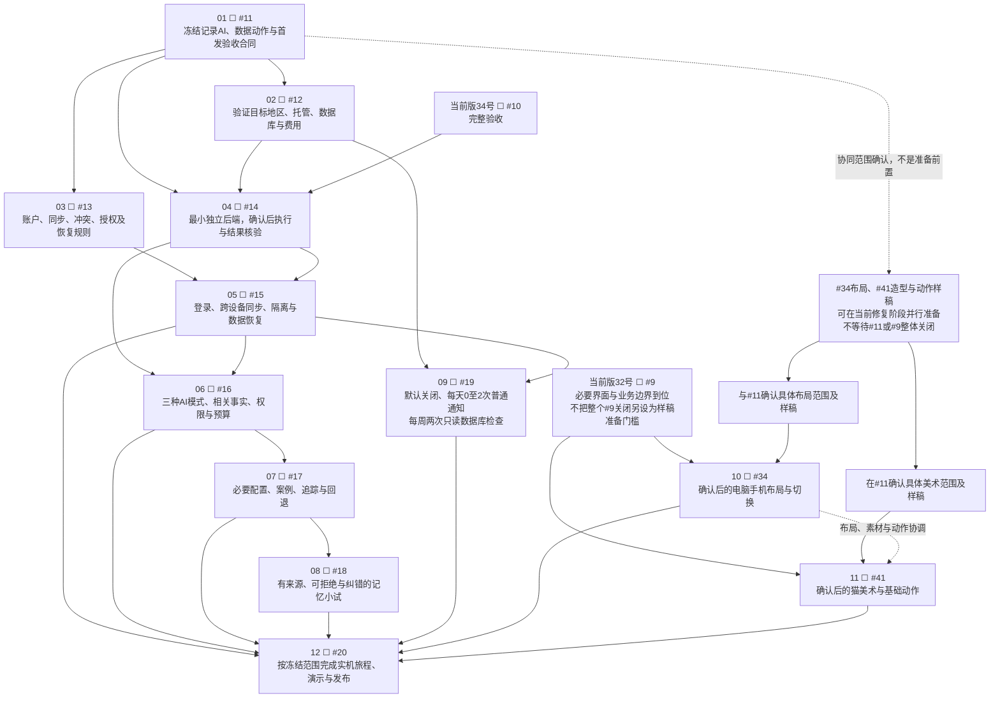

## #28追加复查完成，2026年11月15日

[PR #99](https://github.com/jinzhan857-sketch/juanjuan-to-do-list/pull/99)已复查并合入main bfd48be01508d3164ae39e67abe5e11867a66b9d，保留#81及查询、备注等其他聊天成果。新增18项回归在原main14项失败，修复编辑链接遗漏、超量前截断和无原件快照草稿覆盖新记录的问题。原计分、改时、统计和宠物规则不变。

受检9a16bc2及合入后bfd48be，88项编辑专项、1379项Node、26项稳定断言、无Git归档、54项隔离来源原生浏览器及Windows、Ubuntu云端检查通过。合入后全量和归档再次通过。完整字段、失败输入、重开和保护结果见[复查报告](https://github.com/jinzhan857-sketch/juanjuan-to-do-list/blob/main/docs/audit/2026-11-15/issue28-followup-review.md)与[联合CI](https://github.com/jinzhan857-sketch/juanjuan-to-do-list/actions/runs/43716936515)。#28保持完成关闭，原成果和历史保留。未发布、读取共享Key、调用真实模型或生产Redis、迁移私人资料。其他任务只读依赖用于答复并行建议，没有实施。

## #28完成并停止，2026年11月15日

[PR #94](https://github.com/jinzhan857-sketch/juanjuan-to-do-list/pull/94)已认真复查并合入main 4b4ccaab9c0ffb11d5725bb3fccd90fa0cfce93d，保留上下文、退款及课程备注等其他聊天成果。表单、助手单条与整组共用现有重算和改时规则；展弹窗确认撤销恢复日程与积分流水，保留宠物奖励且不再次喂养。#28原位置及流程图勾选，历史保留。

70项编辑专项、1268项Node、26项稳定断言、无Git归档及38项隔离来源原生浏览器检查通过，Windows、Ubuntu及隔离Redis云端检查通过。合入后同树复验全量及归档通过，受检1933710及合入后955aceb，后者文件树与main 4b4ccaa完全一致。详细输入、字段、时区、原失败与修复见[#28报告](https://github.com/jinzhan857-sketch/juanjuan-to-do-list/blob/main/docs/audit/2026-11-15/issue28-edit-score.md)及[最终CI](https://github.com/jinzhan857-sketch/juanjuan-to-do-list/actions/runs/43713848432)。未发布、调用真实模型、生产Redis或迁移资料；真实手机与模型未验。本聊天至此停止，不继续其他任务。下方历史记录保留。

## #38完整交付，2026年11月15日

[PR #88](https://github.com/jinzhan857-sketch/juanjuan-to-do-list/pull/88)已认真复查、修复并合入main a054044b8e3b071469527e5fd307e7ae6e014afd，#38已关闭，原位置及流程图勾选保留成果。失败取消不占公共次数，通知去重及持久补退、并发20/50/100、跨午夜与#29分工联验通过。保留PR #92、#93等其他聊天成果，#8原已关闭的统计成果继续保留，并补齐其流程图勾选。

1186项Node、26项稳定断言、22项实际Redis、Windows、Ubuntu、无Git归档及各组隔离浏览器通过，证据见[#38报告](https://github.com/jinzhan857-sketch/juanjuan-to-do-list/blob/main/docs/audit/2026-11-15/issue38-quota-refund.md)及[最终CI](https://github.com/jinzhan857-sketch/juanjuan-to-do-list/actions/runs/43712905755)。未发布、读取真实Key、调用真实模型、连接生产Redis或迁移资料。真实手机仍由#55跟踪。完成本轮后停止，不自动继续#28或其他任务。下方阶段性“#38保持打开”“计数未改”等记录保留为历史，不代表当前状态。

## #89、#91合入后复查已完成，2026年11月15日

展要求的#89、#91合入后复查已完成：[PR #92](https://github.com/jinzhan857-sketch/juanjuan-to-do-list/pull/92)检查通过并合入main e41e747fd1c7cbe7d56b5605f9e5d9beea3e4351，受检d880afb2218bde6dfb9a565b68b3e3ef7cb39fe4。

修复一处遗漏：托管接口成功返回null时，先读取字段导致误报网络错误。现在先校验结果，显示“识别失败，请重试。”，不缓存、不自动保存，原文与图片保留。新增14项复查，原main两项失败，修复后全通过；三种额度拒绝后的编辑草稿、原id、附件、跨日时间、手动保存，以及拒绝跨午夜日期均联验。

最终63项联合专项、1150项Node、26项稳定断言、无Git归档、Windows与Ubuntu云端检查及5项独立浏览器通过，报告见[复查记录](https://github.com/jinzhan857-sketch/juanjuan-to-do-list/blob/e41e747fd1c7cbe7d56b5605f9e5d9beea3e4351/docs/audit/2026-11-15/pr89-pr91-followup-review.md)。未修改api、额度、退款、请求编号、取消通知或#38工作区与任务状态；未发布、读取真实密钥、调用真实模型或连接生产Redis。

原任务顺序、完成勾选和历史成果保持，#29继续关闭，本聊天到此停止。

## #29与失败提示规则已分别收尾，2026年11月15日

按展本聊天授权，先独立复查合入[失败短提示PR #89](https://github.com/jinzhan857-sketch/juanjuan-to-do-list/pull/89)，AI失败不再自动快速发布；随后独立复查合入[#29 PR #91](https://github.com/jinzhan857-sketch/juanjuan-to-do-list/pull/91)，#29已关闭，原位置与流程图勾选并保留成果。main 3d39ad4包含其他聊天#27、#30及PR #80、#84全部后续复查成果。

公共额度按北京时间00:00重置，请求按开始日归属，用户日期理解继续保留。展最终确认设备20、网络50、公共接口全站100次，本人用公共接口同样计入，自己的API直连不占公共额度；后续配置与管理入口要求见#16、#82。29项额度专项、1136项Node、26项稳定断言、无Git归档、Windows及Ubuntu云端检查与80组隔离浏览器通过，真实Redis、模型及手机未验。

#38继续保持打开，退款由另一聊天接续，不能声称当前失败取消已不占次数。本聊天到此停止，不自动继续#28或其他任务，未发布、迁移或调用真实模型。下方旧过程保留为历史。

## #27、#30再次复查完成并停止，2026年11月15日

复查新增22项回归，原ef7f876有13项失败；修复普通转换的陈旧详情及顺序重复确认，并补全天、时段日程的隐藏非法时间检查。补查撤销故障和冲突，保留新内容、附件、无关资料、积分与宠物。修复由[PR #90](https://github.com/jinzhan857-sketch/juanjuan-to-do-list/pull/90)合入main 5997747，#27、#30均保持完成关闭，原位置勾选不变。

整合并保留5c21b6a识别失败草稿规则，最终1107项Node、26项稳定断言、无Git归档、Windows和Ubuntu检查及16项真实控件原生合成数据库检查通过，合入main后重新全量及归档通过。详细失败输入、字段和恢复见[复查报告](https://github.com/jinzhan857-sketch/juanjuan-to-do-list/blob/main/docs/audit/2026-11-15/issue27-30-followup-review.md)。本聊天到此停止，未发布、调用模型或迁移，不继续任何其他任务。以下原记录继续保留为历史。

## 2026年11月15日最新确认：识别失败不自动发布

展已更改原规则：识别失败、超时、网络错误和额度拒绝都只显示短提示，保留当前输入、图片及手改字段，不自动快速发布或保存修改。用户主动点击发布或保存后才写入；主动取消不报错误，模型正常追问继续补充。短提示为“网络错误，请重试。”“识别超时，请重试。”“识别失败，请重试。”；个人及公共额度提示按实际限制区分。

本规则正在独立PR实施，验收合入后再完成#29可信日期的独立PR；不发布，不在此PR实施#38退款。下方失败自动发布的旧约定与通过记录保留为历史，由本节替代现行交互规则，日期时间、原文、附件、计分及已有成果继续保留。#47不重开，#38仍按自身范围跟踪。

## #27、#30按序完成并停止，2026年11月15日

先完成#27附件转换PR #86，复查、合入并关闭后，再从最新main实施#30批量校验PR #87。两项已分别通过检查并合入、关闭，原位置勾选保留。最终1065项Node、26项稳定断言、当前提交归档及Windows、Ubuntu检查通过；独立合成数据库分别15项与30项通过，拒绝整库零写入，附件、无关资料、积分宠物保持。

本聊天到此停止，不自动继续其他任务。未发布、调用真实模型或迁移资料。详细字段、失败复现和验收见两项PR内报告，下方各聊天阶段记录保留为历史。

## 本聊天两项获准范围已收尾，2026年11月15日

先完成#38请求保护[PR #80](https://github.com/jinzhan857-sketch/juanjuan-to-do-list/pull/80)，独立复查合入；额度退回按展选择留后续，#38保持打开且原位置不勾选。随后#8统计一致性[PR #84](https://github.com/jinzhan857-sketch/juanjuan-to-do-list/pull/84)已独立复查合入main 04ede657并关闭，下面原位置勾选保留成果。

展弹窗选择首页日程按实际开始日、待办按完成日，报告共用数量，积分仍按结算日。最终23项统计专项、1020项Node、26项稳定断言、无Git归档、Windows和Ubuntu检查及16项独立浏览器通过。统计基线已留给#28复用，不代表编辑计分完成。本轮未发布、真实模型调用或迁移资料，真实手机未验。至此停止，不自动继续#28、#29或其他任务。

## #38 请求保护局部交付，2026年11月15日

[PR #80](https://github.com/jinzhan857-sketch/juanjuan-to-do-list/pull/80)已独立复查修复并合入，997项Node、26项稳定断言、无Git归档、Windows和Ubuntu检查及73组隔离浏览器通过。展选择先完成其他保护，取消退次数留后续，#38保持打开，原位置不勾选；额度实现尚未修改，不能声称失败和取消已不扣次数。剩余保留在#38并与#29可信日期分工联验。现在按本聊天授权进入#8，之后停止，不继续#28、#29，不发布、迁移或真实模型调用。

## #58、#59 已分别复审合入并关闭，2026年11月15日

按展本轮授权，先复查日期[PR #76](https://github.com/jinzhan857-sketch/juanjuan-to-do-list/pull/76)，再复查时间与完整跨日[PR #77](https://github.com/jinzhan857-sketch/juanjuan-to-do-list/pull/77)，发现的缺陷均先复现、修复、补回归后合入main。#58、#59均已关闭，下面原位置勾选并保留成果。最新联合968项Node测试、26项稳定断言、无Git归档、Windows和Ubuntu检查通过；日期39项、时间68项隔离浏览器验收通过。展在复审中确认的夜间钟点边界已同步唯一规则文档。

真实手机与模型未验，未发布、未迁移真实资料；本轮到此停止，不自动继续后续任务。下方待审查、未合入等阶段记录保留为历史，不覆盖本次最终状态。

## 本聊天获准范围已交付，2026年11月15日

按顺序完成日期[PR #76](https://github.com/jinzhan857-sketch/juanjuan-to-do-list/pull/76)，再完成时间及完整跨日[PR #77](https://github.com/jinzhan857-sketch/juanjuan-to-do-list/pull/77)。#77以#76为基线，展已弹窗同意该安排及跨日方案，两项分别审查，不擅自合入。日期受检d6a09c7，时间受检8e474a8；123项日期和209项时间专项，当前894项Node测试、26项稳定断言、无Git归档及Windows、Ubuntu云端检查通过。日期21项、时间34项独立浏览器数据库检查通过。

R01最终三个入口均为2026年11月16日15:00至16:00，原文及第二行备注保留，快速与失败基础价值3，AI成功8.4，仅新增一条未完成记录且零奖励；相关N、C组合已联验。跨日月底跨年、截止超时、改时、实际导出导入、两日日历、撤销、重复奖励保护已执行，证据见#77报告。真实手机和真实模型未验，不冒充通过。

两个Issue暂保留打开待审查合入，总计划不提前勾选整个任务。未发布、未迁移真实资料，不继续#38、#8、#28或其他任务。原有历史记录保留。

## 本聊天日期交付，2026年11月15日

#58已交付待审查[PR #76](https://github.com/jinzhan857-sketch/juanjuan-to-do-list/pull/76)，受检d6a09c7。123项专项、685项Node测试和26项稳定断言、无Git归档及21项独立浏览器数据库检查通过。D组完整字段已核对；分类差异获展授权补齐，多日期手选单条规则已确认。日期与内容部分完成，R01时间及N、C时间组合继续由#59联验，不冒充已通过。待审查合入，暂保留Issue打开和总任务未勾选，不发布。展已同意日期交付后在其成果上继续独立时间交付。原记录保留。

<!-- juanjuan-project-flow:start -->
## 项目流程图：先看两张主图

复查日期：2026年11月15日。只修图解及其说明，下方原任务顺序、勾选、完成记录和历史不变。已逐项核对原当前版34项、3.0的12项及可选4项，并回读复查期间新增的#81、#82、#83，共53项；不把PR当成任务，不给原队列重新编号。

☑表示该Issue按其范围完成，☐表示未完成；合入、发布、真实手机与真实模型分别记录。虚线表示原推荐顺序、准备、复用或联验；实线表示节点写明的必要前置或收尾条件。只有“部分基础到位”的要求，不解释成整个关联Issue必须关闭。

### 主图一：项目整体怎么往下走

先看阶段，再按每格内从左到右、从上到下的原序号找任务。完成与未完成在同一流程，原顺序不变。每个编号的完整名称、验收和成果在下方原清单；展开补充可看到每项独立成框的34项主线。

当前2.5，后续2.x按修复批次交付，再建设3.0云端能力；3.x增强及3.5、4.0概念不重排原任务。新专项与可选研究画在旁线，不塞入原队列。

### 主图二：哪些可以多线做，在哪里等与汇合

实线看必须满足的条件，虚线看并行准备或协作。#38完整请求与退次验收已完成；#8统计基线已交付，#28继续按自身范围实施。各线可以并行定位和准备，同一区域代码分步整合，具体条件见折叠补充。

3.0也可分线：#12与#13、#16至#18与#19；#34与#41样稿可提前准备。各自必要前置及范围确认仍须满足，完整连线见折叠补充。

复查补充：逐项主线、精确前置、3.0分支与SOP

### 并行边界、最新状态与版本定位

这是依赖与协作图，不是另一份施工队列。#38与#8没有相互关闭前置；#38已完成请求保护、退次及与#29的可信日期联验，#8统计基线已交付，#28仍沿用#6保护按其独立范围实施。#27、#30、#31、#39以及界面各项不因画在同一分支就相互等待。

并行定位、样例、测试和样稿准备，不等于同一区域同时改代码。共享index.html中的执行、校验、计分、撤销、导航、CSS或渲染入口须分步整合；#38与#29共改api/ai.js时同样协调。#63基本规范可提前供#61复用，#61不等待#8、#34或整个#63关闭。#55在包含对应修复的受检入口逐项验手机，不等待#9结束；入口如需发布仍须授权。

图中简写的#9前置保留原完整要求，精确名单见折叠补充。#10的清单、样本和恢复方案可先准备，汇合条件约束最终收尾，不能把发布与恢复验证画在#10完成之后。已有#59完整跨日继续与后续计分、导入和手机场景联验，不反向重开或重排已关闭任务。

#38现已完整交付：失败或取消不占公共AI次数，主动重试使用新编号，程序不自动重试；请求保护、原子计数、持久补退及#29日期联验已在PR #88复查通过并合入关闭。#81本机测试已在PR #97完成并关闭，不等待完整3.0；#82公网共享AI与#83稳定访问、域名方案尚待讨论，二者联合核验。新专项复用#12、#14、#16、#29、#38等原任务，不能因本机测试完成便开放公网，也不自动把三项加入原#9、#10或#20的完成门槛。当前代先开小范围公共AI试验如涉及范围变化，仍先确认。

当前已发布定位是2.5，2.6、2.7等按实际修复批次命名，不为版本号重排任务。3.0完成原确认的云端受控事务流程；3.x可继续查错和增强，#78是用户主动周复盘候选。3.5、4.0仍是概念，既有3.0记忆小试、普通通知、布局与美术不后移。早期1.0、1.4左右及2.0的产品演变保留在[版本定位](https://github.com/jinzhan857-sketch/juanjuan-to-do-list/blob/main/docs/product/VERSION_POSITIONING.md)，这里不再单画一张历史版本图。

### 当前版本逐项主线，保持原01至34顺序

四列从左向右，每列从上向下接续。每个任务恰有一个主节点，#59同日和完整跨日仍是一个任务。这里全部虚线仅表示原推荐队列，不增加逐项关闭门槛。

### 当前版本精确前置与完整验收

#9原必要前置为#3、#4、#5、#6、#7、#8、#27、#28、#30、#43、#47成果验收合入，并有#37关键导入与恢复证据；不要求把#44或#55另设为其启动门槛。#10保留原21项明确前置，本轮已选功能与组合验收、#55真实手机证据及已有成果继续按原范围核对。

各独立任务的启动条件也不能合成一个“大基础”：#8依赖#2；#28依赖#6、#8；#27依赖#2、#3、#6；#30依赖#5；#31依赖#4、#5。#38和#29可在#2、#3后准备，#39可在#2、#3后只读定位；涉及导入再协调#6复验。#32、#33、#63、#61按各自Issue使用已具备的工程基础，不新增#37等关闭要求。#29仍是实际公共AI接口开放前的阻塞项。

#37与#6原本可配套推进，关键故障证据在#6合入前取得，不是必须等#6整个关闭才开始#37。#47实施唯一硬前置为#6验收合入；#43、#44可与#47同轮协作并分别验收，不相互等待关闭。这些已有成果留在原位，后续复查不能误读为新增加的串行依赖。

| 可并行准备 | 代码与验收边界 |
| --- | --- |
| #38请求异常与#8统计 | 没有相互关闭前置；共享保存、奖励及状态流程联合回归 |
| #38请求链与#29额度日期 | 分别定位和离线测试；请求和计数区域分步整合，#38完整验收需#29结果 |
| #27附件、#30校验、#31上下文、#39备注定位 | 启动条件分别核对；与#28共改助手执行、校验或撤销入口时避免同时修改 |
| #32滚动、#33键盘、#63规范、#61信息栏 | 规范和样稿可先准备，同一布局、导航与CSS分步整合 |
| #55手机证据与开发、#9拆分 | 按包含相应修复的版本逐项收集，#10结束前齐备 |

06号#37、07号#64、08号#40、19号#65及20至22号#62、#66、#57继续在主线原位参与复查；不把它们归成所有任务共同的启动门槛，不擅自清洗旧资料或放宽存储保护。

### 3.0完整依赖与可提前准备的工作

原3.0编号01至12不变。#14仍需#10、#11、#12成果，#15仍需#13、#14，#16仍需#14、#15，#17需#16，#18需#17，#19需#12、#15。#34、#41按各自范围与必要边界实施，布局和美术相互协调，不增加彼此整项关闭前置；最终#15至#19及#34、#41汇入#20。

在线业务继续优先JavaScript，Python优先独立评测与分析；Anthropic作为必要运行机制参考，nanoMuse仅作局部机制与测试对照。[借鉴方案](https://github.com/jinzhan857-sketch/juanjuan-to-do-list/blob/main/docs/reference/agent-learning-plan.md)不让完整常驻Agent、全部候选库或第二套业务后端成为新增前置。#18可形成有证据的暂不扩大结论，#19区分服务接受与设备实际显示。

### 可选项与复查SOP

原可选顺序仍为#53、#51、#52、#78。#53按具体问题选择工具，不要求整项关闭后才做评测；#52等待#51最小数据集、判定与运行记录可用，不等待整个#51关闭。#78依赖#16、#17相关基础验收合入后另确认试验范围与预算，不等待#18、#51或#52关闭；仅由用户主动发起，不新增默认后台周报、推送或跨应用执行。四项均不反向阻塞当前版本或3.0发布。

每个Issue沿同一SOP处理：读最新任务与受检版本，核对本次范围和前置，Bug先复现定位，重大方案先确认，实施或复验，核对完整字段与最终数据，再记录提交、命令、结果和未测范围。附件、积分、宠物、失败、取消和恢复一同核对。通过后按原完成条件审查合入、原位勾选；未完验收留在原任务或明确接手任务，发布另按授权执行。后续涉及该区域继续回归已完成成果，不重复开发或自动重开Issue。越范围、内容丢失、重复奖励、关键回归失败或无法恢复时，停止相应交付并保留证据。

<!-- juanjuan-project-flow:end -->

## 当前版本，按实施顺序连续排列

完成项留在流程原位置打勾，后续顺着往下看，不按完成状态拆成不同清单。当前版本共34个任务，每个任务只列一条；#59的两段工作写在同一条里。下面是推荐施工顺序，原有必要依赖继续有效，不新增逐项关闭的硬前置。

- [x] 01．[#2：保存电脑上的最新代码，让 GitHub 下载后也能检查](https://github.com/jinzhan857-sketch/juanjuan-to-do-list/issues/2)
- [x] 02．[#3：统一启动、打包和自动检查的方法](https://github.com/jinzhan857-sketch/juanjuan-to-do-list/issues/3)
- [x] 03．[#4：修复“只改一天，却改到整组”的问题](https://github.com/jinzhan857-sketch/juanjuan-to-do-list/issues/4)
- [x] 04．[#5：让 AI 正确识别同一组重复日程](https://github.com/jinzhan857-sketch/juanjuan-to-do-list/issues/5)
- [x] 05．[#6：防止导入或批量修改中途失败造成数据丢失](https://github.com/jinzhan857-sketch/juanjuan-to-do-list/issues/6)
- [x] 06．[#37：专项验证导入格式、重复记录与事务失败后的数据恢复](https://github.com/jinzhan857-sketch/juanjuan-to-do-list/issues/37)
- [x] 07．[#64：导入校验失败时指出具体记录与错误字段，帮助定位无法恢复的备份](https://github.com/jinzhan857-sketch/juanjuan-to-do-list/issues/64)。已交付[PR #68](https://github.com/jinzhan857-sketch/juanjuan-to-do-list/pull/68)，复审及最终CI通过，已合入，未发布。
- [x] 08．[#40：排查并恢复卷卷 GitHub Pages 地址在电脑和手机均返回 404](https://github.com/jinzhan857-sketch/juanjuan-to-do-list/issues/40)
- [x] 09．[#47：发布日程与待办改为左侧 AI 识别、右侧快速发布，优先实施](https://github.com/jinzhan857-sketch/juanjuan-to-do-list/issues/47)
- [x] 10．[#43：修复 AI 识别后已选执行日期失效，必须再次选日期才能发布](https://github.com/jinzhan857-sketch/juanjuan-to-do-list/issues/43)
- [x] 11．[#44：发布日程的执行日期默认显示整月，移除展开和收起](https://github.com/jinzhan857-sketch/juanjuan-to-do-list/issues/44)
- [x] 12．[#7：查询天气时优先使用用户这次说的城市](https://github.com/jinzhan857-sketch/juanjuan-to-do-list/issues/7)
- [x] 13．[#60：发布表单保留用户原文，优先按换行整理任务定义与备注](https://github.com/jinzhan857-sketch/juanjuan-to-do-list/issues/60)。本轮补充原文与换行备注、快速发布和AI失败入口联验。 本轮内容专项PR #74待审查合入，R01及N、C完整组合仍待验，该阶段记录保留。 PR #74现已复审合入，#60已关闭，组合待验转交对应任务。
- [x] 14．[#58：独立发布表单日期识别，支持口语日期并保护手选日期](https://github.com/jinzhan857-sketch/juanjuan-to-do-list/issues/58)。本轮补充默认今年补录、12月到1月跨年例外、明确本周过去日期，以及仅月份提示切换待办。
- [x] 15．[#59：独立时间识别，完善全部时段、单端补足一小时与跨日执行](https://github.com/jinzhan857-sketch/juanjuan-to-do-list/issues/59)。分两步执行，仍是同一任务：先做同日时间、全部时段、单端补一小时和模糊钟点固定提示；完整跨日先审查数据表示，再与#8、#28相关规则联验，不因分步新增任务。
- [x] 16．[#38：统一验证并修复请求超时、取消后返回、重试与额度计数](https://github.com/jinzhan857-sketch/juanjuan-to-do-list/issues/38)。已完成请求保护、失败取消去重退次、迟到及防重复保存，与#29可信日期联合验收；[PR #88](https://github.com/jinzhan857-sketch/juanjuan-to-do-list/pull/88)已复查合入并关闭。
- [x] 17．[#8：修复完成数量和统计报告对不上的问题](https://github.com/jinzhan857-sketch/juanjuan-to-do-list/issues/8)。已复查合入[PR #84](https://github.com/jinzhan857-sketch/juanjuan-to-do-list/pull/84)并关闭；完成数量按日程开始日与待办完成日统计，积分保留结算日流水。
- [x] 18．[#28：统一助手与表单编辑日程的积分重算和改时规则](https://github.com/jinzhan857-sketch/juanjuan-to-do-list/issues/28)。成果：[PR #94](https://github.com/jinzhan857-sketch/juanjuan-to-do-list/pull/94)，已合入并完成编辑、撤销与失败恢复联验。；追加复查：[PR #99](https://github.com/jinzhan857-sketch/juanjuan-to-do-list/pull/99)，保留原成果与勾选。
- [x] 19．[#65：修复近期待办与长期待办的数量未随当前范围变化](https://github.com/jinzhan857-sketch/juanjuan-to-do-list/issues/65)。PR #69已合入，原成果与验收记录保留，未发布。
- [x] 20．[#62：修复首页待确认任务提醒被数字和文字拆散的排版](https://github.com/jinzhan857-sketch/juanjuan-to-do-list/issues/62)。PR #70已合入并关闭；真实手机待验在#55，未来信息栏正文检查在#61，原成果和验收记录保留。
- [x] 21．[#66：修复季度待办的最后三分之一提醒过早触发](https://github.com/jinzhan857-sketch/juanjuan-to-do-list/issues/66)。PR #71已复审并合入main 18496da，#66已关闭；44项专项、417项Node检查及Windows、Ubuntu检查通过，未发布。
- [x] 22．[#57：精简任务详情的信息顺序、积分文案、操作按钮与编辑规则说明](https://github.com/jinzhan857-sketch/juanjuan-to-do-list/issues/57)。PR #73已复审并合入main，#57已关闭；详情关闭、编辑及窄屏复验通过，联合433项Node测试及Windows、Ubuntu检查通过，真实手机继续在#55待验，旧数据和实际所得保留，未发布。
- [x] 23．[#27：修复助手将日程转成待办时丢失图片和链接](https://github.com/jinzhan857-sketch/juanjuan-to-do-list/issues/27)
- [x] 24．[#30：补齐批量修改遗漏的标题分数和时间字段校验](https://github.com/jinzhan857-sketch/juanjuan-to-do-list/issues/30)
- [x] 25．[#31：修复事务上下文只取最早 100 条导致近期日程遗漏](https://github.com/jinzhan857-sketch/juanjuan-to-do-list/issues/31)。PR #93已独立复查合入，1160项Node、26项稳定断言、归档、25项原生浏览器及双平台CI通过，任务已关闭，未发布。 后续独立复查PR #98已合入main 8b6cb1b，新增14项、1361项Node、26项稳定断言、归档及68项原生浏览器和双平台、隔离Redis CI通过，保留原成果，未发布。 PR #98后再次复查由[PR #102](https://github.com/jinzhan857-sketch/juanjuan-to-do-list/pull/102)合入8eb0ffb，37项新增、1434项Node、26项稳定断言、归档及101项原生浏览器和双平台、隔离Redis CI通过，历史记录保留，未发布。
- [x] 26．[#29：修复公共 AI 额度使用客户端日期导致计数可绕过](https://github.com/jinzhan857-sketch/juanjuan-to-do-list/issues/29)
- [x] 27．[#32：修复底部导航切换时滚动条闪现引起页面横向跳动](https://github.com/jinzhan857-sketch/juanjuan-to-do-list/issues/32)。成果：[PR #96](https://github.com/jinzhan857-sketch/juanjuan-to-do-list/pull/96)，桌面和真实手机动态验收、1392项Node、归档与双平台CI通过，未发布。
- [ ] 28．[#33：修复助手输入聚焦误判键盘弹出导致底部导航消失](https://github.com/jinzhan857-sketch/juanjuan-to-do-list/issues/33)
- [x] 29．[#39：定位并修复课程教授备注重复的问题](https://github.com/jinzhan857-sketch/juanjuan-to-do-list/issues/39)。PR #95已独立复查合入，12项专项、1198项Node、26项稳定断言、归档、24项原生浏览器及双平台和隔离Redis CI通过，任务已关闭；历史重复原样保留，未发布。 后续独立复查PR #98已合入main 8b6cb1b，新增14项、1361项Node、26项稳定断言、归档及68项原生浏览器和双平台、隔离Redis CI通过，保留原成果，未发布。 PR #98后再次复查由[PR #102](https://github.com/jinzhan857-sketch/juanjuan-to-do-list/pull/102)合入8eb0ffb，37项新增、1434项Node、26项稳定断言、归档及101项原生浏览器和双平台、隔离Redis CI通过，历史记录保留，未发布。
- [ ] 30．[#63：统一全部主题的简约控件规范，新增灰白配色与默认关闭的界面阴影](https://github.com/jinzhan857-sketch/juanjuan-to-do-list/issues/63)
- [ ] 31．[#61：首页增加未读信息入口，收纳状态提醒并精简空态文案](https://github.com/jinzhan857-sketch/juanjuan-to-do-list/issues/61)。继续承接#62未来信息栏正文复验。
- [ ] 32．[#9：拆清页面、数据、积分和 AI 代码](https://github.com/jinzhan857-sketch/juanjuan-to-do-list/issues/9)
- [ ] 33．[#55：真实手机验收发布表单、日期保持与整月日历，承接 #47、#43、#44 待验项](https://github.com/jinzhan857-sketch/juanjuan-to-do-list/issues/55)。包含本轮规则组合验收与承接#62的正文、字体和窄屏待验。
- [ ] 34．[#10：验证下载、运行、发布和恢复的完整流程](https://github.com/jinzhan857-sketch/juanjuan-to-do-list/issues/10)。保留原有必要前置，汇总本轮相关组合验收与发布恢复证据。

#59同日部分不等待#28或#9关闭，完整跨日必须先审查数据表示与结算方案，再与相关计分联验。#28仍复用#6、#8。#38发布失败部分先验证，完整超时、取消、请求链和计数继续与#29分工联验，不自行决定新扣减或退款规则。

独立小修可以在不覆盖其他聊天成果的前提下提前交付。涉及同一index.html的任务分步提交、复验，不覆盖同一未合入改动。手机证据随开发收集，到#55统一收尾；#10保留原有硬前置，不因推荐顺序形成新的循环依赖。

## 接手与验收要求

1. 读AGENTS.md、docs/STATUS.md、实施接手和指定Issue最新正文，核对git status、main与正式网站来源。旧正文排期只作历史，当前顺序只维护在本页。
2. 先复现再修复，固定时钟、时区和合成资料；检查输入、表单、最终数据库、数量、无关资料、附件、积分和宠物，不只检查成功文案。
3. 模拟模型、真实模型、电脑、真实手机、合入、发布分别记录。新增验收没有执行前不勾选，整个任务达到完成条件后才关闭。
4. 不重复建任务，不擅自批量清洗旧资料、增加兼容、迁移、依赖或变更技术选型。私人备份、原文和派生截图不公开，公开回归用合成资料。
5. 越范围写入、内容丢失、重复奖励、关键检查退步或无法恢复时，停止对应交付并保留证据；正式发布、真实模型和数据迁移仍按具体授权执行。

本次重排前完整正文保存在[历史快照](https://github.com/jinzhan857-sketch/juanjuan-to-do-list/blob/main/docs/history/2026-11-15-roadmap-before-playtest-review.md)，原有评论归档继续保留；历史中的旧顺序不再作为活动队列。

## 当前版本完成后，进入3.0

以下同样按主要实施顺序排列。方案讨论可以提前；各Issue明确的数据保护和必要依赖仍需核对。

- [ ] 01．[#11：确定 3.0 的发布规则、数据格式和验收标准](https://github.com/jinzhan857-sketch/juanjuan-to-do-list/issues/11)
- [ ] 02．[#12：验证免费服务能否支撑香港和大陆使用](https://github.com/jinzhan857-sketch/juanjuan-to-do-list/issues/12)
- [ ] 03．[#13：确定登录、跨设备同步和旧数据保留规则](https://github.com/jinzhan857-sketch/juanjuan-to-do-list/issues/13)
- [ ] 04．[#14：搭建后端，跑通一条完整事务流程](https://github.com/jinzhan857-sketch/juanjuan-to-do-list/issues/14)
- [ ] 05．[#15：实现邮箱登录、跨设备同步和数据恢复](https://github.com/jinzhan857-sketch/juanjuan-to-do-list/issues/15)
- [ ] 06．[#16：接通三种 AI 模式，管理工具权限和体验额度](https://github.com/jinzhan857-sketch/juanjuan-to-do-list/issues/16)
- [ ] 07．[#17：让提示词和工作流可调整，错误可追查](https://github.com/jinzhan857-sketch/juanjuan-to-do-list/issues/17)
- [ ] 08．[#18：试验自动整理记忆，验证能否纠错和追溯来源](https://github.com/jinzhan857-sketch/juanjuan-to-do-list/issues/18)
- [ ] 09．[#19：实现少量网页通知和每周两次数据库检查](https://github.com/jinzhan857-sketch/juanjuan-to-do-list/issues/19)
- [ ] 10．[#34：完善电脑与手机自适应布局，提供布局切换方案](https://github.com/jinzhan857-sketch/juanjuan-to-do-list/issues/34)
- [ ] 11．[#41：在 3.0 完成卷卷小猫新美术与基础动作改版](https://github.com/jinzhan857-sketch/juanjuan-to-do-list/issues/41)
- [ ] 12．[#20：完成 3.0 实机验收、演示和发布](https://github.com/jinzhan857-sketch/juanjuan-to-do-list/issues/20)

后端优先JavaScript，依据[决策0002](https://github.com/jinzhan857-sketch/juanjuan-to-do-list/blob/main/docs/decisions/0002-backend-language.md)。#34整体双端布局、#41宠物美术保留原范围，不阻塞当前版本的独立小项。

PR #75已合入，已按[借鉴方案](https://github.com/jinzhan857-sketch/juanjuan-to-do-list/blob/main/docs/reference/agent-learning-plan.md)细化原任务的操作与验收。先把记录AI做准确，再建设云端受控执行；Anthropic提供运行机制参考，nanoMuse只提供局部机制与测试对照。

- #11明确记录AI完整流程及对照标准，#13、#15补账户、在途请求及授权资料的隔离与失效。
- #14、#16补业务确认、实际结果核验、重复执行保护及预算停止；#17只做必要配置与运行记录，#18保留有来源、可拒绝和可纠错的记忆试验。
- #19沿用默认关闭、每天0至2次的普通提醒，服务接受与手机实际显示分别验收；#20按冻结范围完成真实旅程，不以接入框架代替验收。
- #53逐项小试选型，#51、#52可复用场景和结果判定但仍属可选研究。各Issue原前置、已完成成果与必要验收保留，未增加依赖或发布门槛。

本轮不重排当前修复或3.0任务，不拆完成与未完成，不改代码。下方较早“待审核”“只挂入口”的补充保留为历史；当前选中原则以本节和原任务的新增操作、验收为准，具体库与候选功能不因此自动获准接入。周复盘另列为3.x候选#78，不塞入#17，3.5与4.0仍为概念。
## 2026年11月15日新增：AI测试、共享接口与稳定访问专项

展要求将三件事分别建任务。当前只登记和讨论，不在本轮实施代码、部署、购买、迁移或真实模型调用。三个任务开工前均须先与展讨论并确认本轮范围、方案、预算和验收，在对应Issue记录共识后执行；#81方向已同意，#82、#83尚未选定实施方案，不因建任务或第一项完成而自动获准工作。

- [x] [#81：本机启动AI服务，让Codex安全读取密钥并运行测试](https://github.com/jinzhan857-sketch/juanjuan-to-do-list/issues/81)。已由[PR #97](https://github.com/jinzhan857-sketch/juanjuan-to-do-list/pull/97)合入关闭；本机共享Key、有限真实测试、合成数据库确认及撤销通过，[测试题与实际回答](https://github.com/jinzhan857-sketch/juanjuan-to-do-list/blob/main/docs/audit/2026-11-15/issue81-acceptance.md)。
- [ ] [#82：待讨论，提供公网共享AI接口，明确平台、密钥保护和费用额度](https://github.com/jinzhan857-sketch/juanjuan-to-do-list/issues/82)。平台、地域、免费条件、完整费用及公共额度须先与展达成共识。
- [ ] [#83：待讨论，验证大陆不翻墙访问卷卷，确定域名和正式入口](https://github.com/jinzhan857-sketch/juanjuan-to-do-list/issues/83)。是否买域名、费用、网络验收及旧数据保护须先确认，与#82联合验证。

这是展本轮新增的专项入口，不重排上方当前版本和3.0既定队列，不改变原任务必要前置，不按完成与未完成拆栏。#12仍负责托管环境验证，#29、#38、#16仍按原范围承接额度和请求保护，#14、#13、#15仍按原计划负责完整业务后端、账户和同步；专项复用其成果，不复制业务规则或提前关闭原任务。朋友提出的Vercel、Supabase、Cloudflare域名组合只是候选，未被确认为正式技术方案。

## 可选研究，按需要推进

这些不是当前版本发布的前置，不因为列在这里就自动安装工具或运行模型。

- [ ] 01．[#53：评估并选择卷卷可复用的开源工具与产品方案，先小试再接入](https://github.com/jinzhan857-sketch/juanjuan-to-do-list/issues/53)
- [ ] 02．[#51：后续评测：参考 AgentBench 验证卷卷能否正确完成个人事务](https://github.com/jinzhan857-sketch/juanjuan-to-do-list/issues/51)
- [ ] 03．[#52：后续试验：参考 EdgeBench 评测卷卷的多轮任务与错误恢复](https://github.com/jinzhan857-sketch/juanjuan-to-do-list/issues/52)

- [ ] 04．[#78：3.x候选：试验用户主动发起的每周复盘](https://github.com/jinzhan857-sketch/juanjuan-to-do-list/issues/78)

## 规则、测试与图片入口

源码与工程基础见PR #24、#26；范围与组身份见PR #35、#36；存储保护见PR #46，独立恢复验收见PR #54；天气见PR #48；发布表单、日期保持与整月日历见PR #50；免费Pages恢复见PR #42、#45；V2.5版本展示见PR #56。资料与规则复审见[PR #67](https://github.com/jinzhan857-sketch/juanjuan-to-do-list/pull/67)。已完成代码不等于所有真实手机场景通过，手机证据仍由#55跟踪。

- [最后确认的规则](https://github.com/jinzhan857-sketch/juanjuan-to-do-list/blob/main/docs/reference/2026-11-15-confirmed-feedback-rules.md)。
- [130条完整字段测试预期](https://github.com/jinzhan857-sketch/juanjuan-to-do-list/blob/main/docs/reference/2026-11-15-confirmed-feedback-tests.md)。这是待实施预期，不是功能通过报告。
- [三张授权界面截图](https://github.com/jinzhan857-sketch/juanjuan-to-do-list/blob/main/docs/audit/2026-11-15/feedback-images/README.md)。
- [PR #67复审记录](https://github.com/jinzhan857-sketch/juanjuan-to-do-list/blob/main/docs/audit/2026-11-15/pr67-review.md)。
- [接手状态](https://github.com/jinzhan857-sketch/juanjuan-to-do-list/blob/main/docs/STATUS.md)、[产品](https://github.com/jinzhan857-sketch/juanjuan-to-do-list/blob/main/docs/product/README.md)、[架构](https://github.com/jinzhan857-sketch/juanjuan-to-do-list/blob/main/docs/architecture/README.md)、[开发](https://github.com/jinzhan857-sketch/juanjuan-to-do-list/blob/main/docs/development/README.md)。

正文按版本与既定范围维护实施顺序；完成状态只用原位置的勾选表示，不再按完成与否拆开排列。详细规则和证据在各Issue及对应文档。

## 发布、保护与历史

正式网站：[卷卷V2.5](https://jinzhan857-sketch.github.io/juanjuan-to-do-list/?v=2.5)。仓库按展确认公开，继续免费GitHub Pages；公开不等于已选择开源许可证。Pages只运行静态文件，不执行api/ai.js。实现、验收、资料合入、网站发布分别记录，不自动上线。

私人备份、真实明细和密钥不入库。公开测试用合成数据；本机私有参考副本仅按授权用于独立来源体验，不发给模型。禁止擅自新增兼容、批量清洗原始资料或迁移真实数据。越范围写入、内容丢失、重复计分、关键检查退步或无法恢复时停止相应执行并保留证据。

重排前的完整正文已保存在本Issue的“执行清单重排前的完整正文归档”评论中，包含旧分类、依赖图、未定项、成果和历史，不删除原记录。

页面顶部的“6 / 19”仅统计最早19个原生子任务，不包括后来通过链接登记的全部任务，不能当作本页完整进度。

本次核对前的接手摘要，作为历史保留

以下为更新前的过程记录，不代表当前状态；活动清单与勾选以上方为准。

本聊天已按顺序完成复审：先[PR #71](https://github.com/jinzhan857-sketch/juanjuan-to-do-list/pull/71)，再[PR #73](https://github.com/jinzhan857-sketch/juanjuan-to-do-list/pull/73)，分别检查通过并合入main，#66、#57均已关闭。联合433项Node测试、26项稳定断言及Windows、Ubuntu最终检查和归档检查通过；真实手机仍由#55待验，未发布，不推进后续任务。下方资料阶段与中间接手结论保留为历史。

本聊天复审进度：#71已复审通过并合入main，#66已关闭；接着只复审#73。未发布，不推进后续任务。下方资料阶段表述保留为历史。

最新已核对main为615f4e4。#65、#62均已合入并关闭；#62真实手机待验转#55，未来信息栏正文复验转#61，原成果和失败证据保留。试玩发生在较早的e3af20d，不能把当时#65现象当成最新main仍未修复。正式站点版本须另看build-info.json，本轮没有发布。

资料交付：[PR #72](https://github.com/jinzhan857-sketch/juanjuan-to-do-list/pull/72)。执行期间其他聊天交付了#66的[PR #71](https://github.com/jinzhan857-sketch/juanjuan-to-do-list/pull/71)与#57的[PR #73](https://github.com/jinzhan857-sketch/juanjuan-to-do-list/pull/73)，#66的PR #71现已复审合入，#66已关闭；#57的PR #73现已复审合入，#57已关闭。均未发布。接手先核对已有成果和本轮要求，补缺口或复验，不重复开发，不把分支通过当作main已修复。其原交付记录完整保留在各任务和重排前快照中。

## 2026年11月15日补充：版本定位与nanoMuse研究

展授权先整理版本定位，再将研究与语言分工并入原任务。本次资料见[PR #75](https://github.com/jinzhan857-sketch/juanjuan-to-do-list/pull/75)：[版本定位](https://github.com/jinzhan857-sketch/juanjuan-to-do-list/blob/5c489ee7e1377e8961e1864933c0d22eaea011ef/docs/product/VERSION_POSITIONING.md)、[nanoMuse研究](https://github.com/jinzhan857-sketch/juanjuan-to-do-list/blob/5c489ee7e1377e8961e1864933c0d22eaea011ef/docs/reference/nanomuse-research.md)、[语言分工](https://github.com/jinzhan857-sketch/juanjuan-to-do-list/blob/5c489ee7e1377e8961e1864933c0d22eaea011ef/docs/decisions/0003-javascript-python-boundary.md)。当前版本仍为2.5，2.6、2.7等按实际批次修稳；1.4左右作为早期过渡标志，3.5与4.0仅为未讨论清楚的概念候选。

对应关系：#53管理研究与许可，#14承接语言与业务边界，#16、#17参考授权、预算、上下文和工作流，#18承接记忆试验，#19参考原通知范围，#41参考猫的执行状态，#51、#52参考评测方法，#11、#20承接版本与发布判断。不新建重复实施任务，不关闭这些原任务。

当前修复顺序、下一任务、原3.0范围、必要依赖、验收与历史记录保持不变。增强能力不自动成为首发前置，原3.0任务也不因候选版本被直接后移。研究评测继续选做；JavaScript在线业务优先，Python优先独立评测、分析与模型实验，新增在线服务需另行提出具体方案。

本轮仅资料整理，未改应用、依赖或版本号，未发布、迁移真实数据、写回飞书或调用真实模型。文档已在任务分支与PR保存，合入状态以PR为准。

## 2026年11月15日补充：产品主线与架构借鉴方案，待审核

展已确认：卷卷以生活日程和待办的可靠记录为基础，事务理解与整理是主要AI能力；规划、聊天和提醒基于相关事实、授权资料与实际反馈。后续运行机制主要参考Anthropic，nanoMuse保留局部实现、交互和测试参考，不作为整套底座。

资料入口：[版本定位与开源借鉴](https://github.com/jinzhan857-sketch/juanjuan-to-do-list/blob/7cd53af54d7ba5639b7870a78bd921adeb856f48/docs/product/VERSION_POSITIONING.md)、[具体借鉴方案，待审核](https://github.com/jinzhan857-sketch/juanjuan-to-do-list/blob/7cd53af54d7ba5639b7870a78bd921adeb856f48/docs/reference/agent-learning-plan.md)、[产品主线与参考层级](https://github.com/jinzhan857-sketch/juanjuan-to-do-list/blob/7cd53af54d7ba5639b7870a78bd921adeb856f48/docs/decisions/0004-product-and-architecture-references.md)，均在[PR #75](https://github.com/jinzhan857-sketch/juanjuan-to-do-list/pull/75)。方案逐项说明学什么、不学什么、原因、试验、候选版本和原任务映射；文章、SDK、开源项目和商业产品分别管理，不是必须全部安装的清单。

本次先供审核，#53挂研究入口，其他子任务不批量追加实施范围。审核后只将选中的具体操作和验收并入原Issue；确需改顺序、依赖或已确认3.0范围时再列具体变动供展确认。现有nanoMuse补充继续作为局部研究，不表示额外实现获批。

原修复顺序、下一任务、必要依赖与验收不变，做完和未做仍放在原位置，只改勾选，不拆开排列。3.5与4.0仍为未讨论清楚的概念候选。本轮不改代码、接口、依赖、版本号或发布，不安装工具、不调用真实模型、不迁移资料。

## 2026年11月15日补充：PR #75文档复审修正

展要求认真复审版本与借鉴方案，仅修正文档。六处修正及依据见[PR #75复审记录](https://github.com/jinzhan857-sketch/juanjuan-to-do-list/blob/00a569c0b9c76c70eb023351a130083f966f9747/docs/audit/2026-11-15/pr75-review.md)，主要内容为[复审修订方案](https://github.com/jinzhan857-sketch/juanjuan-to-do-list/blob/00a569c0b9c76c70eb023351a130083f966f9747/docs/reference/agent-learning-plan.md)及[版本定位与开源借鉴](https://github.com/jinzhan857-sketch/juanjuan-to-do-list/blob/00a569c0b9c76c70eb023351a130083f966f9747/docs/product/VERSION_POSITIONING.md)：优先完善记录AI的理解、校验、确认与保存；不把完整常驻框架设为3.0前置；提醒服从原默认关闭和每天0至2次，区分发送与真实到达；补账户与记忆授权、业务重复执行的验收设计；4.0不预设必须跨应用或操控设备。

原14组验收草案补充为24组，均未执行，不作为能力通过。Anthropic主要参考、nanoMuse局部参考及JavaScript在线业务方向保留。文档复审不代表全部候选功能获准开发，具体范围仍由原任务确认；本次不批量扩子任务，不改下一任务、顺序、前置、原验收或完成勾选，不拆完成与未完成，未改代码或发布。资料保存在[PR #75](https://github.com/jinzhan857-sketch/juanjuan-to-do-list/pull/75)，合入状态以PR为准。

2026年11月15日：#27已由PR #86复查合入并关闭，1028项Node、26项稳定断言、归档及双平台CI通过，原生合成数据库15项通过。未发布。随后#30由PR #87完成，见下方收尾记录。

## AI日用广测与复测专项，当前版本

- [ ] [#104：执行AI日用160题广测，集中复现问题并建立修复后复测流程](https://github.com/jinzhan857-sketch/juanjuan-to-do-list/issues/104)。

启动位置：承接已完成的#81，建议下一轮先测20类各1题，再分批覆盖160题，尽量在#9大范围拆分前留下实测基线。本机执行不等#82、#83、完整3.0或可选研究#51、#52；不改变原主线顺序及必要前置。每批开始前确认题目、预期、模型、请求次数和费用上限，#81旧额度已经用满。

执行流程：广泛测试 → 失败区域增加不同变体与必要重复 → 归并已有或新问题Issue → 按风险和依赖挂回#1 → 修复任务用原题及邻近题复测 → 更新报告和测试集。第一轮结果、遗留续测安排和问题交接验收后关闭#104，后续缺陷继续由各自Issue跟进。当前只建任务，160题仍未执行。

### 已保存的测试资料与原交付记录

展于2026年11月15日要求先建立多样、覆盖日用场景且能反复复测的测试集，已由[PR #103](https://github.com/jinzhan857-sketch/juanjuan-to-do-list/pull/103)保存到main：[完整160题](https://github.com/jinzhan857-sketch/juanjuan-to-do-list/blob/main/docs/development/ai-testset/cases.md)、[20类覆盖与执行方法](https://github.com/jinzhan857-sketch/juanjuan-to-do-list/blob/main/docs/development/ai-testset/README.md)、[合成场景](https://github.com/jinzhan857-sketch/juanjuan-to-do-list/blob/main/docs/development/ai-testset/fixtures.json)、[执行及问题记录模板](https://github.com/jinzhan857-sketch/juanjuan-to-do-list/blob/main/docs/development/ai-testset/run-template.md)。每题有入口、准备、原话或步骤、预期及禁止行为；全部标为未执行，资料与工程检查通过不等于这些自然语言题已经测过，也不预报问题总数。

后续先广泛覆盖，再围绕失败区域做8至12个不同变体和必要重复，保留实际回答、字段、最终存储与失败频率；确定事实、原因假设和待明确需求分开。按共同原因归并已有或新Issue，再按风险和依赖排入本总计划，修复后原题及邻近题复测。关键误写或泄露不需等大量失败才登记；不把每道题各建一张任务，也不为了原句通过持续堆特例。

本次只交付测试资料，未修改应用代码、运行160题、调用模型或新建缺陷任务，不重排现有队列。#81保持已完成，#82、#83仍先讨论；真实测试需另定当轮预算，不沿用#81已用满的10次。
