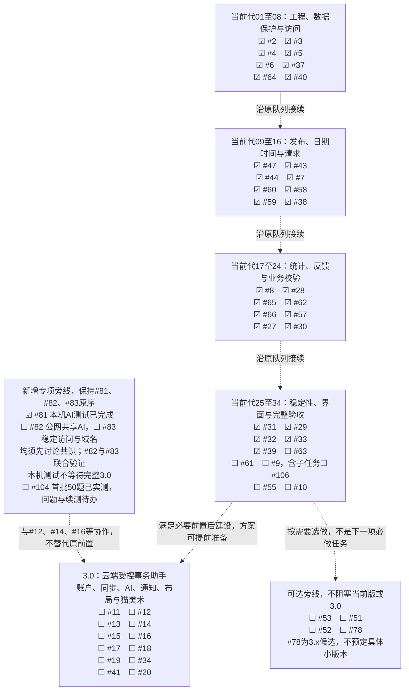
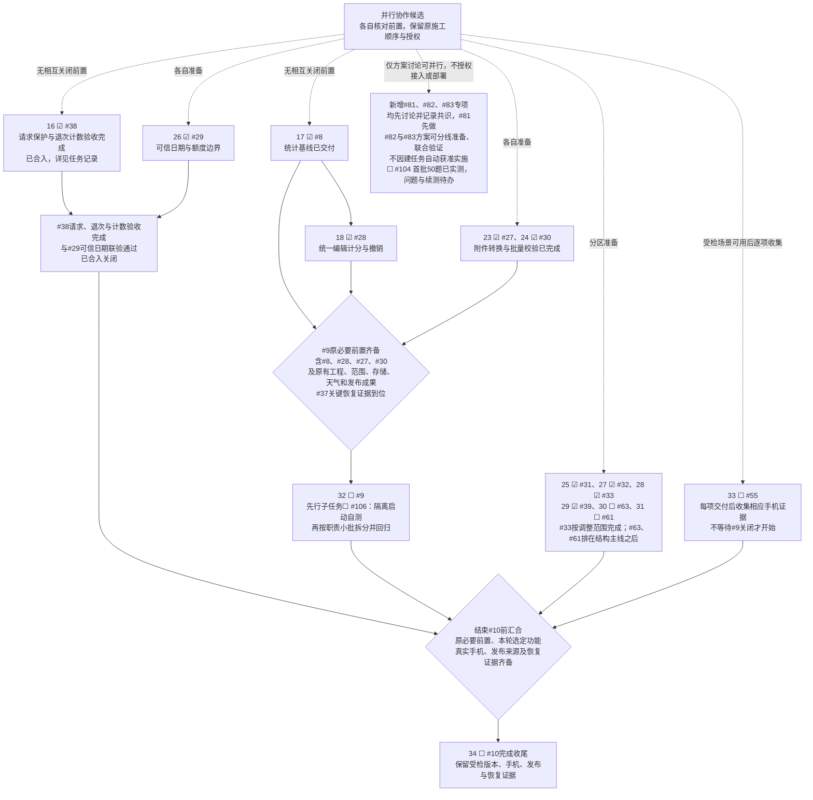

# 卷卷开发总计划

本页只维护流程图、任务顺序、完成状态和入口。详细规则、交付与复查记录见各任务；整理前正文已[完整归档](https://github.com/jinzhan857-sketch/juanjuan-to-do-list/blob/main/docs/history/2026-11-15-roadmap-before-compaction.md)，更早历史见[归档索引](https://github.com/jinzhan857-sketch/juanjuan-to-do-list/blob/main/docs/history/README.md)。

当前以记录准确、执行反馈一致为主线。近期执行按下方已确认安排，原编号与任务位置保留供追溯，不把清单位置另解为一套新排期；必要依赖以各任务正文为准。已完成项留在原位置，不重复开发。

## 近期结构整理的优先级

展于2026年11月16日确认近期安排：#33已按展调整后的范围完成，#110、#117暂缓；#104按最新50题交接独立准备和执行；下一批结构工作优先#106启动自测隔离，再围绕具体流程小批推进#9。#63、#61保留原承诺，排在结构主线之后，不抢占共享代码修改时间。#55手机证据仍可按受检场景逐项收集，不等待#9关闭。

P1结构主线的原硬前置及#37关键恢复证据已核对到位，就绪依据与批次验收只在[#9](https://github.com/jinzhan857-sketch/juanjuan-to-do-list/issues/9)维护；实施时仍固定最新main并跑相关基线。已获授权任务不打断，共享页面改动串行整合，每批合入后下一批更新main。本次只同步计划，不启动代码任务。

#104建议在大范围拆分前留AI实测基线，但不是#9或#106硬前置；首批50题按#104已批准预算和交接执行，新增或超出本批范围的真实调用另确认。#10、#14至#17沿原依赖承接，不为整理提前建设完整后端、配置平台或新增兼容。协作与停止条件见[结构接手](https://github.com/jinzhan857-sketch/juanjuan-to-do-list/blob/main/docs/development/STRUCTURE_HANDOFF.md)。本轮仅登记计划，尚未实施拆分。

## 项目流程图

☑表示任务按其范围完成，☐表示未完成。虚线表示推荐顺序、准备或协作，实线表示节点写明的必要前置或收尾条件。合入、发布、真实手机和真实模型分别记录。

### 主图一：阶段与任务

### 主图二：协作、依赖与收尾

#9保留原完整硬前置及#37关键恢复证据要求，不等待#37所有体验项；#10保留原完整前置、本轮选定功能和#55手机收尾。具体范围分别进入[#9](https://github.com/jinzhan857-sketch/juanjuan-to-do-list/issues/9)、[#10](https://github.com/jinzhan857-sketch/juanjuan-to-do-list/issues/10)、[#55](https://github.com/jinzhan857-sketch/juanjuan-to-do-list/issues/55)核对。

## 当前版本，保留原编号与任务位置

原主线共34项，#106作为#9的子任务列在原位置之下，不另建主线。完成项保留原位置，详细验收与成果进入对应任务查看。

- [x] 01．[#2：保存电脑上的最新代码，让 GitHub 下载后也能检查](https://github.com/jinzhan857-sketch/juanjuan-to-do-list/issues/2)
- [x] 02．[#3：统一启动、打包和自动检查的方法](https://github.com/jinzhan857-sketch/juanjuan-to-do-list/issues/3)
- [x] 03．[#4：修复“只改一天，却改到整组”的问题](https://github.com/jinzhan857-sketch/juanjuan-to-do-list/issues/4)
- [x] 04．[#5：让 AI 正确识别同一组重复日程](https://github.com/jinzhan857-sketch/juanjuan-to-do-list/issues/5)
- [x] 05．[#6：防止导入或批量修改中途失败造成数据丢失](https://github.com/jinzhan857-sketch/juanjuan-to-do-list/issues/6)
- [x] 06．[#37：专项验证导入格式、重复记录与事务失败后的数据恢复](https://github.com/jinzhan857-sketch/juanjuan-to-do-list/issues/37)
- [x] 07．[#64：导入校验失败时指出具体记录与错误字段，帮助定位无法恢复的备份](https://github.com/jinzhan857-sketch/juanjuan-to-do-list/issues/64)
- [x] 08．[#40：排查并恢复卷卷 GitHub Pages 地址在电脑和手机均返回 404](https://github.com/jinzhan857-sketch/juanjuan-to-do-list/issues/40)
- [x] 09．[#47：发布日程与待办改为左侧 AI 识别、右侧快速发布，优先实施](https://github.com/jinzhan857-sketch/juanjuan-to-do-list/issues/47)
- [x] 10．[#43：修复 AI 识别后已选执行日期失效，必须再次选日期才能发布](https://github.com/jinzhan857-sketch/juanjuan-to-do-list/issues/43)
- [x] 11．[#44：发布日程的执行日期默认显示整月，移除展开和收起](https://github.com/jinzhan857-sketch/juanjuan-to-do-list/issues/44)
- [x] 12．[#7：查询天气时优先使用用户这次说的城市](https://github.com/jinzhan857-sketch/juanjuan-to-do-list/issues/7)
- [x] 13．[#60：发布表单保留用户原文，优先按换行整理任务定义与备注](https://github.com/jinzhan857-sketch/juanjuan-to-do-list/issues/60)
- [x] 14．[#58：独立发布表单日期识别，支持口语日期并保护手选日期](https://github.com/jinzhan857-sketch/juanjuan-to-do-list/issues/58)
- [x] 15．[#59：独立时间识别，完善全部时段、单端补足一小时与跨日执行](https://github.com/jinzhan857-sketch/juanjuan-to-do-list/issues/59)
- [x] 16．[#38：统一验证并修复请求超时、取消后返回、重试与额度计数](https://github.com/jinzhan857-sketch/juanjuan-to-do-list/issues/38)
- [x] 17．[#8：修复完成数量和统计报告对不上的问题](https://github.com/jinzhan857-sketch/juanjuan-to-do-list/issues/8)
- [x] 18．[#28：统一助手与表单编辑日程的积分重算和改时规则](https://github.com/jinzhan857-sketch/juanjuan-to-do-list/issues/28)
- [x] 19．[#65：修复近期待办与长期待办的数量未随当前范围变化](https://github.com/jinzhan857-sketch/juanjuan-to-do-list/issues/65)
- [x] 20．[#62：修复首页待确认任务提醒被数字和文字拆散的排版](https://github.com/jinzhan857-sketch/juanjuan-to-do-list/issues/62)
- [x] 21．[#66：修复季度待办的最后三分之一提醒过早触发](https://github.com/jinzhan857-sketch/juanjuan-to-do-list/issues/66)
- [x] 22．[#57：精简任务详情的信息顺序、积分文案、操作按钮与编辑规则说明](https://github.com/jinzhan857-sketch/juanjuan-to-do-list/issues/57)
- [x] 23．[#27：修复助手将日程转成待办时丢失图片和链接](https://github.com/jinzhan857-sketch/juanjuan-to-do-list/issues/27)
- [x] 24．[#30：补齐批量修改遗漏的标题分数和时间字段校验](https://github.com/jinzhan857-sketch/juanjuan-to-do-list/issues/30)
- [x] 25．[#31：修复事务上下文只取最早 100 条导致近期日程遗漏](https://github.com/jinzhan857-sketch/juanjuan-to-do-list/issues/31)
- [x] 26．[#29：修复公共 AI 额度使用客户端日期导致计数可绕过](https://github.com/jinzhan857-sketch/juanjuan-to-do-list/issues/29)
- [x] 27．[#32：修复底部导航切换时滚动条闪现引起页面横向跳动](https://github.com/jinzhan857-sketch/juanjuan-to-do-list/issues/32)，[PR #96](https://github.com/jinzhan857-sketch/juanjuan-to-do-list/pull/96)。
- [x] 28．[#33：修复助手输入聚焦误判键盘弹出导致底部导航消失](https://github.com/jinzhan857-sketch/juanjuan-to-do-list/issues/33)，[PR #118](https://github.com/jinzhan857-sketch/juanjuan-to-do-list/pull/118)；按展调整范围完成，未解决的[#110](https://github.com/jinzhan857-sketch/juanjuan-to-do-list/issues/110)、[#117](https://github.com/jinzhan857-sketch/juanjuan-to-do-list/issues/117)另列暂缓。
- [x] 29．[#39：定位并修复课程教授备注重复的问题](https://github.com/jinzhan857-sketch/juanjuan-to-do-list/issues/39)
- [ ] 30．[#63：统一全部主题的简约控件规范，新增灰白配色与默认关闭的界面阴影](https://github.com/jinzhan857-sketch/juanjuan-to-do-list/issues/63)
- [ ] 31．[#61：首页增加未读信息入口，收纳状态提醒并精简空态文案](https://github.com/jinzhan857-sketch/juanjuan-to-do-list/issues/61)
- [ ] 32．[#9：拆清页面、数据、积分和 AI 代码](https://github.com/jinzhan857-sketch/juanjuan-to-do-list/issues/9)
  - [ ] [#106：将启动自测迁出正式运行，隔离合成数据与回归入口](https://github.com/jinzhan857-sketch/juanjuan-to-do-list/issues/106)
- [ ] 33．[#55：真实手机验收发布表单、日期保持与整月日历，承接 #47、#43、#44 待验项](https://github.com/jinzhan857-sketch/juanjuan-to-do-list/issues/55)
- [ ] 34．[#10：验证下载、运行、发布和恢复的完整流程](https://github.com/jinzhan857-sketch/juanjuan-to-do-list/issues/10)

## 当前版本完成后，进入3.0

方案可按授权提前讨论，原有必要依赖不变。版本定位与借鉴范围见[版本说明](https://github.com/jinzhan857-sketch/juanjuan-to-do-list/blob/main/docs/product/VERSION_POSITIONING.md)、[具体借鉴方案](https://github.com/jinzhan857-sketch/juanjuan-to-do-list/blob/main/docs/reference/agent-learning-plan.md)。

- [ ] 01．[#11：确定 3.0 的发布规则、数据格式和验收标准](https://github.com/jinzhan857-sketch/juanjuan-to-do-list/issues/11)
- [ ] 02．[#12：验证免费服务能否支撑香港和大陆使用](https://github.com/jinzhan857-sketch/juanjuan-to-do-list/issues/12)
- [ ] 03．[#13：确定登录、跨设备同步和旧数据保留规则](https://github.com/jinzhan857-sketch/juanjuan-to-do-list/issues/13)
- [ ] 04．[#14：搭建后端，跑通一条完整事务流程](https://github.com/jinzhan857-sketch/juanjuan-to-do-list/issues/14)
- [ ] 05．[#15：实现邮箱登录、跨设备同步和数据恢复](https://github.com/jinzhan857-sketch/juanjuan-to-do-list/issues/15)
- [ ] 06．[#16：接通三种 AI 模式，管理工具权限和体验额度](https://github.com/jinzhan857-sketch/juanjuan-to-do-list/issues/16)
- [ ] 07．[#17：让提示词和工作流可调整，错误可追查](https://github.com/jinzhan857-sketch/juanjuan-to-do-list/issues/17)
- [ ] 08．[#18：试验自动整理记忆，验证能否纠错和追溯来源](https://github.com/jinzhan857-sketch/juanjuan-to-do-list/issues/18)
- [ ] 09．[#19：实现少量网页通知和每周两次数据库检查](https://github.com/jinzhan857-sketch/juanjuan-to-do-list/issues/19)
- [ ] 10．[#34：完善电脑与手机自适应布局，提供布局切换方案](https://github.com/jinzhan857-sketch/juanjuan-to-do-list/issues/34)
- [ ] 11．[#41：在 3.0 完成卷卷小猫新美术与基础动作改版](https://github.com/jinzhan857-sketch/juanjuan-to-do-list/issues/41)
- [ ] 12．[#20：完成 3.0 实机验收、演示和发布](https://github.com/jinzhan857-sketch/juanjuan-to-do-list/issues/20)

## AI测试、共享接口与稳定访问专项

保持原旁线顺序，不替代3.0后端、账户、同步及额度任务。#82、#83须先讨论范围、方案、预算与验收，分别准备、联合验证。

- [x] [#81：本机启动AI服务，让Codex安全读取密钥并运行测试](https://github.com/jinzhan857-sketch/juanjuan-to-do-list/issues/81)
- [ ] [#82：待讨论，提供公网共享AI接口，明确平台、密钥保护和费用额度](https://github.com/jinzhan857-sketch/juanjuan-to-do-list/issues/82)
- [ ] [#83：待讨论，验证大陆不翻墙访问卷卷，确定域名和正式入口](https://github.com/jinzhan857-sketch/juanjuan-to-do-list/issues/83)

## 可选研究，按需要推进

不阻塞当前版本或3.0；#78仅为3.x候选，不预定具体小版本。

- [ ] 01．[#53：评估并选择卷卷可复用的开源工具与产品方案，先小试再接入](https://github.com/jinzhan857-sketch/juanjuan-to-do-list/issues/53)
- [ ] 02．[#51：后续评测：参考 AgentBench 验证卷卷能否正确完成个人事务](https://github.com/jinzhan857-sketch/juanjuan-to-do-list/issues/51)
- [ ] 03．[#52：后续试验：参考 EdgeBench 评测卷卷的多轮任务与错误恢复](https://github.com/jinzhan857-sketch/juanjuan-to-do-list/issues/52)
- [ ] 04．[#78：3.x候选：试验用户主动发起的每周复盘](https://github.com/jinzhan857-sketch/juanjuan-to-do-list/issues/78)

## 规则与接手入口

[AGENTS.md](https://github.com/jinzhan857-sketch/juanjuan-to-do-list/blob/main/AGENTS.md)、[接手状态](https://github.com/jinzhan857-sketch/juanjuan-to-do-list/blob/main/docs/STATUS.md)、[实施接手](https://github.com/jinzhan857-sketch/juanjuan-to-do-list/blob/main/docs/development/HANDOFF_CONFIRMED_RULES.md)、[确认规则](https://github.com/jinzhan857-sketch/juanjuan-to-do-list/blob/main/docs/reference/2026-11-15-confirmed-feedback-rules.md)、[字段测试预期](https://github.com/jinzhan857-sketch/juanjuan-to-do-list/blob/main/docs/reference/2026-11-15-confirmed-feedback-tests.md)、[文档导航](https://github.com/jinzhan857-sketch/juanjuan-to-do-list/blob/main/docs/README.md)。

识别失败只提示并保留草稿，主动发布或保存后才写入。先复现再修复；各任务保留实际结果、受检版本与未测范围，测试预期不等于验收通过。真实手机待验继续由#55跟踪。

## 发布、保护与历史

正式静态入口：[卷卷V2.5](https://jinzhan857-sketch.github.io/juanjuan-to-do-list/?v=2.5)。合入不自动发布，发布来源与恢复规则见[发布说明](https://github.com/jinzhan857-sketch/juanjuan-to-do-list/blob/main/docs/development/RELEASE.md)。公开仓库尚未选择开源许可证，Pages不运行服务端AI接口。

私人资料、备份和密钥不入库，公开验证使用合成资料；不擅自清洗、迁移或新增兼容。越范围写入、内容丢失、重复奖励或关键检查退步时停止对应交付并保留证据。发布、迁移与真实模型调用分别取得授权。

维护时只更新原任务勾选、两图状态和必要入口，详细交付记录放到对应任务与报告，见[维护规则](https://github.com/jinzhan857-sketch/juanjuan-to-do-list/blob/main/docs/ROADMAP.md#如何维护)。原评论、旧快照均保留；页面原生子任务计数不代表本页完整进度。

## AI日用广测与复测专项，当前版本

- [ ] [#104：执行AI日用160题广测，集中复现问题并建立修复后复测流程](https://github.com/jinzhan857-sketch/juanjuan-to-do-list/issues/104)

160题是总题库，首批50题已实测，44道模型题共52次真实请求；原结果、已确认规则、暂缓项及后续入口只在[#104最新接手正文](https://github.com/jinzhan857-sketch/juanjuan-to-do-list/issues/104)维护。首批资料与证据已上传[草稿PR #116](https://github.com/jinzhan857-sketch/juanjuan-to-do-list/pull/116)，尚未合入main，不把保存误称修复或发布。余下110题未执行，真实复测和联网验证另定预算，不重置唯一账本或复用#81。#104及以下新增项均不成为#106新硬前置。

本批后续任务入口，具体范围、原样本、验收及状态在各任务维护，执行时先协调共享文件，不用下面清单擅自打断已授权工作：

- [ ] [#111：更正后旧确认卡仍会误建](https://github.com/jinzhan857-sketch/juanjuan-to-do-list/issues/111)
- [ ] [#112：编辑年待办丢失原周期](https://github.com/jinzhan857-sketch/juanjuan-to-do-list/issues/112)
- [ ] [#113：明确目标仍被范围校验拦截，整组追加保留各自备注](https://github.com/jinzhan857-sketch/juanjuan-to-do-list/issues/113)
- [ ] [#114：明确跨夜起止无法发布](https://github.com/jinzhan857-sketch/juanjuan-to-do-list/issues/114)
- [ ] [#115：已确认支持多事项和多组重复的候选及确认](https://github.com/jinzhan857-sketch/juanjuan-to-do-list/issues/115)
- [ ] [#119：聊天联网，展明确要求的重要能力](https://github.com/jinzhan857-sketch/juanjuan-to-do-list/issues/119)
- [ ] [#120：普通任务直接生成、粗评分、分类及说明](https://github.com/jinzhan857-sketch/juanjuan-to-do-list/issues/120)
- [ ] [#121：逐步数据核对、图片及关键网页证据，第18项方案待确认](https://github.com/jinzhan857-sketch/juanjuan-to-do-list/issues/121)

第9项迟到结果、第10项全站额度、第11项规划小场景、第14项助手待办周期、第15项天气按展决定暂缓，触发续接条件见#104。天气暂缓不等于聊天联网#119暂缓。第18项无需展现在确认，恢复时按#121处理；当前不启动代码或新真实请求。
