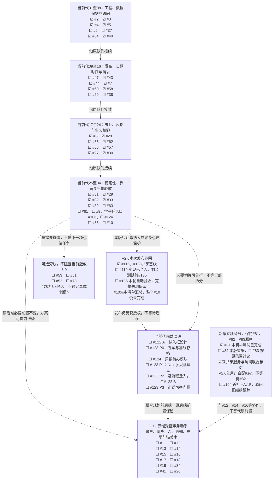
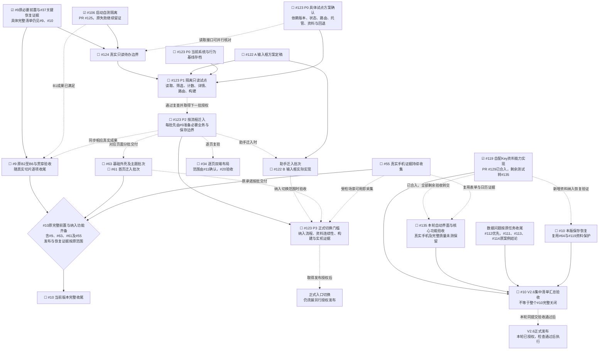

# 卷卷开发总计划

本页只维护流程图、任务顺序、完成状态和入口。详细规则、交付与复查记录见各任务；整理前正文已[完整归档](https://github.com/jinzhan857-sketch/juanjuan-to-do-list/blob/main/docs/history/2026-11-15-roadmap-before-compaction.md)，更早历史见[归档索引](https://github.com/jinzhan857-sketch/juanjuan-to-do-list/blob/main/docs/history/README.md)。

本轮调整前正文已[逐字保存](https://github.com/jinzhan857-sketch/juanjuan-to-do-list/blob/70fec6fafd22e82eba20a55fc7b497265362d6dc/docs/history/2026-11-16-roadmap-before-nextjs-planning.md)。[配套文档PR #126](https://github.com/jinzhan857-sketch/juanjuan-to-do-list/pull/126)已合入main，正式接手入口为[结构整理与迁移接手](https://github.com/jinzhan857-sketch/juanjuan-to-do-list/blob/main/docs/development/STRUCTURE_HANDOFF.md)、[路线图说明](https://github.com/jinzhan857-sketch/juanjuan-to-do-list/blob/main/docs/ROADMAP.md)及[当前状态](https://github.com/jinzhan857-sketch/juanjuan-to-do-list/blob/main/docs/STATUS.md)；各任务正文为当前活动范围。

总计划正文由总协调 Codex 统一维护，实施交接和架构复查见[总协调与实施交接](https://github.com/jinzhan857-sketch/juanjuan-to-do-list/blob/main/docs/ROADMAP.md#总协调与实施交接)。

当前以记录准确、执行反馈一致为主线，近期先收尾V2.6用户自配Key版本。原编号与任务位置保留供追溯，不把清单位置另解为一套新排期；必要依赖以各任务正文为准。已完成项留在原位置，不重复开发。本轮同步前正文已[逐字归档](https://github.com/jinzhan857-sketch/juanjuan-to-do-list/issues/1#issuecomment-6913376008)，保留UTF8校验值与原等待说明。

## 近期安排与下一步

本轮快速上线：展已确认由两个Codex聊天完成必要修复、自动验收及发布，减少真人参与。[完整执行约定](https://github.com/jinzhan857-sketch/juanjuan-to-do-list/issues/10#issuecomment-6916606633)，[聊天1修复入口](https://github.com/jinzhan857-sketch/juanjuan-to-do-list/issues/112#issuecomment-6916630721)，[聊天2验收与发布入口](https://github.com/jinzhan857-sketch/juanjuan-to-do-list/issues/135#issuecomment-6916631202)。聊天1提交PR并在#112交接，聊天2自行读取GitHub后复查整合，检查通过即执行本轮已授权的Pages发布；展无需中转结果或逐项手测。真人广测和复杂质量完整矩阵保留未测，本轮不作上线硬前置；关键数据保护、真实自配连通、保存恢复、最终检查和线上版本核对必须通过。未测不记通过，#10/#135完整任务不因快速上线关闭，3.0规划不变。

V2.6先由用户自行配置Key，优先交付并验证自配DeepSeek路径；#82公网共享AI接口本版暂缓，不作为发布前置，也不记为完成。版本范围和5项验收只维护在[#10的V2.6发布清单](https://github.com/jinzhan857-sketch/juanjuan-to-do-list/issues/10#issuecomment-6912317918)，本页只安排顺序与入口。[本轮交接文件](https://github.com/jinzhan857-sketch/juanjuan-to-do-list/blob/main/docs/development/V26_COORDINATOR_HANDOFF.md)经PR #141复核合入；本次未发布网站。

已核对main 8fe7c8e：#115由[PR #130](https://github.com/jinzhan857-sketch/juanjuan-to-do-list/pull/130)交付关闭，#133由[PR #134](https://github.com/jinzhan857-sketch/juanjuan-to-do-list/pull/134)交付关闭，随后界面[PR #136](https://github.com/jinzhan857-sketch/juanjuan-to-do-list/pull/136)、[PR #138](https://github.com/jinzhan857-sketch/juanjuan-to-do-list/pull/138)、[PR #140](https://github.com/jinzhan857-sketch/juanjuan-to-do-list/pull/140)均已合入。统一卷卷入口已由#119复用，[PR #129](https://github.com/jinzhan857-sketch/juanjuan-to-do-list/pull/129)实现与复查修复已合入；#119按展决定关闭，全部剩余验收转#135。自动、聊天、规划、事务仅作本条意图提示，不恢复成能力限制。既有检查通过不代表#135全部验收或V2.6发布通过。

#32已由PR #96完成；#33已由PR #118按展调整范围完成，#110、#117仍未解决并暂缓。#106已由[PR #125](https://github.com/jinzhan857-sketch/juanjuan-to-do-list/pull/125)合入main 5056e34并关闭；42条原自测中40条通过，两条原始失败及后续核对保留在[#106交接](https://github.com/jinzhan857-sketch/juanjuan-to-do-list/issues/106#issuecomment-6899359893)。#9整体仍未完成，已关闭共享入口任务不重新实施。

| 阶段 | 当前推荐工作与承接 | 开始与进入下一步的条件 |
| --- | --- | --- |
| 现在，V2.6双聊天并行 | 聊天1复核并必要修复#112、#111、#113、#114；聊天2在#135/#10先做自动检查、合成保存恢复和发布准备 | 聊天1是本阶段唯一共享应用代码修改者；聊天2先不改共享代码、不提前发布，发现问题登记原任务；真人与完整复杂质量覆盖本轮可保留未测 |
| 修复交付与接管 | 聊天1在#112写明确交接和PR，停止改共享代码；聊天2自行读取GitHub，复查并整合，必要时接管修正 | 不要求展中转；未找到PR不等于无改动可交付。原案例、相关回归和遗留有结论，再固定最终受检提交 |
| 本版自动验收与发布 | 聊天2按#10本轮清单核对自配AI、数据及附件、保存恢复、浏览器核心流程、构建、同提交归档和CI，通过后发布既有Pages并核对正式站 | 本轮展已授权通过后发布，不重复确认；关键失败仍阻塞，未测设备和质量矩阵如实保留。交付上线链接后结束，不等整个#10、#135或Next.js迁移 |
| 后续迁移准备 | #123的P0负责当前系统和行为基线存档、迁移方案，并与#11、#12、#13、#14联合讨论定稿前后端架构，详见[#11](https://github.com/jinzhan857-sketch/juanjuan-to-do-list/issues/11)；#122的A阶段定稿输入框样稿和交互。#63提供共用控件、主题与阴影规范，并按已确认设计skill要求复查；#34准备双端布局方案 | 可在不影响当前实施时独立整理，样稿、已实现与已验收分别记录；不在旧HTML完整重做新UI，不因本次规划启动框架或迁移 |
| 迁移所需读取切片 | #9子任务#124，提取真实待办读取、筛选、计数、详情和展示状态模块，旧界面复用 | 原工程与恢复前置、#106已满足；固定最新main、登记边界并取得本批授权，涉及#135后续修复等同一共享文件时串行交接，不改写流程 |
| 首个隔离试点 | #123的P1，只读待办，核对路由、构建与真实模块读取 | #124验收合入、#122的A阶段定稿、当前系统行为存档，以及依赖版本、组件状态、路由、托管、资料连续性和回退方案获确认；不等#122的B阶段或整个#9完成 |
| 试点通过后 | #123的P2逐批迁入，每批先由#9拆出必要业务与保存边界。#63在基础外壳及主题批次交付，#61随首页迁入交付，#122的B阶段随助手迁入实现 | 每批单独明确授权、范围与验收，保留现有输入与消息界面成果，不复制业务规则或打包整套发布器 |
| 完整工程与原3.0承诺 | #123的P3维护正式切换门槛，#9、#55、#10按各自完整范围收尾；#34随页面迁入复验，完整范围仍由#11确认并在#20验收 | #63、#61等原承诺保留，未完成项继续跟踪。V2.6清单不替代#10原完整前置，迁移正式切换仍另获发布授权 |

#119已由[PR #129](https://github.com/jinzhan857-sketch/juanjuan-to-do-list/pull/129)完成实现与复查修复并合入，受检19d98cc、合入8fe7c8e；[CI #318](https://github.com/jinzhan857-sketch/juanjuan-to-do-list/actions/runs/43856965395)的Ubuntu、Windows和Redis专项通过，报告记录本地及同提交归档1560项通过。本轮核对了main与受检提交文件树一致，没有重新执行功能验收。[最终交接](https://github.com/jinzhan857-sketch/juanjuan-to-do-list/issues/119#issuecomment-6915397810)按展决定将#119关闭，全部剩余测试统一归[#135完整清单](https://github.com/jinzhan857-sketch/juanjuan-to-do-list/issues/135#issuecomment-6915371326)，包括真机、复杂图片与混合多轮质量、故障保存与事务保护、原26条矩阵证据、费用和将来获发布授权后的正式站新构建端到端。旧“未实施、等待方案、#119保留质量队列”均为历史，未测项不改为通过。原专项100次10元随剩余验收继续使用原账本，执行前重读，不清零、不合并其他额度；供应商实扣尚未核对。

#104首批50题已留实测基线，后续问题与复测继续在#104及#111至#115、#120、#121等原任务维护，不为V2.6另建一套任务。#111、#113、#114不能仅凭仍开放认定旧错误还在，也不能用新流程的无关测试销账；必须给原案例和邻近回归结论。#131、#132既有延期和#139撤销状态显示问题保留原归属，发布结论由#10结合实际影响汇总，不自动销账。

#9原必要前置与#37关键恢复证据、#10原完整工程收尾、#14至#17原依赖保留。#124只提供必要读取切片，不关闭#9；#123与#9不互相等待整体关闭。V2.6是#10下本次选定版本范围，不把Next.js、账户同步、RAG、#82或整个#10关闭新增为本版前置。涉及本版正确性、保存恢复的必要保护不能省略，发现未满足项先给证据和最小处理方案。具体验收只在原任务和本版清单维护。

## 项目流程图

☑表示任务按其范围完成，☐表示未完成。虚线表示推荐顺序、准备或协作，实线表示节点写明的必要前置或收尾条件。合入、发布、真实手机和真实模型分别记录。

### 主图一：阶段与任务

### 主图二：必要依赖与分批收尾

#9保留原完整硬前置及#37关键恢复证据要求，不等待#37所有体验项；图中G10是整个#10的完整工程收尾门槛，CHECK26仅为本次V2.6集中清单，两者不混用。#10原完整前置及#55手机收尾保留，本版必要数据与恢复保护按原任务验证。具体范围分别进入[#9](https://github.com/jinzhan857-sketch/juanjuan-to-do-list/issues/9)、[#10](https://github.com/jinzhan857-sketch/juanjuan-to-do-list/issues/10)、[#55](https://github.com/jinzhan857-sketch/juanjuan-to-do-list/issues/55)核对。

## 当前版本，保留原编号与任务位置

原主线共34项，#106、#124作为#9子任务列在原位置之下，新增迁移任务另列入口，不重编号或移走原任务。完成项保留原位置，详细验收与成果进入对应任务查看。

- [x] 01．[#2：保存电脑上的最新代码，让 GitHub 下载后也能检查](https://github.com/jinzhan857-sketch/juanjuan-to-do-list/issues/2)
- [x] 02．[#3：统一启动、打包和自动检查的方法](https://github.com/jinzhan857-sketch/juanjuan-to-do-list/issues/3)
- [x] 03．[#4：修复“只改一天，却改到整组”的问题](https://github.com/jinzhan857-sketch/juanjuan-to-do-list/issues/4)
- [x] 04．[#5：让 AI 正确识别同一组重复日程](https://github.com/jinzhan857-sketch/juanjuan-to-do-list/issues/5)
- [x] 05．[#6：防止导入或批量修改中途失败造成数据丢失](https://github.com/jinzhan857-sketch/juanjuan-to-do-list/issues/6)
- [x] 06．[#37：专项验证导入格式、重复记录与事务失败后的数据恢复](https://github.com/jinzhan857-sketch/juanjuan-to-do-list/issues/37)
- [x] 07．[#64：导入校验失败时指出具体记录与错误字段，帮助定位无法恢复的备份](https://github.com/jinzhan857-sketch/juanjuan-to-do-list/issues/64)
- [x] 08．[#40：排查并恢复卷卷 GitHub Pages 地址在电脑和手机均返回 404](https://github.com/jinzhan857-sketch/juanjuan-to-do-list/issues/40)
- [x] 09．[#47：发布日程与待办改为左侧 AI 识别、右侧快速发布，优先实施](https://github.com/jinzhan857-sketch/juanjuan-to-do-list/issues/47)
- [x] 10．[#43：修复 AI 识别后已选执行日期失效，必须再次选日期才能发布](https://github.com/jinzhan857-sketch/juanjuan-to-do-list/issues/43)
- [x] 11．[#44：发布日程的执行日期默认显示整月，移除展开和收起](https://github.com/jinzhan857-sketch/juanjuan-to-do-list/issues/44)
- [x] 12．[#7：查询天气时优先使用用户这次说的城市](https://github.com/jinzhan857-sketch/juanjuan-to-do-list/issues/7)
- [x] 13．[#60：发布表单保留用户原文，优先按换行整理任务定义与备注](https://github.com/jinzhan857-sketch/juanjuan-to-do-list/issues/60)
- [x] 14．[#58：独立发布表单日期识别，支持口语日期并保护手选日期](https://github.com/jinzhan857-sketch/juanjuan-to-do-list/issues/58)
- [x] 15．[#59：独立时间识别，完善全部时段、单端补足一小时与跨日执行](https://github.com/jinzhan857-sketch/juanjuan-to-do-list/issues/59)
- [x] 16．[#38：统一验证并修复请求超时、取消后返回、重试与额度计数](https://github.com/jinzhan857-sketch/juanjuan-to-do-list/issues/38)
- [x] 17．[#8：修复完成数量和统计报告对不上的问题](https://github.com/jinzhan857-sketch/juanjuan-to-do-list/issues/8)
- [x] 18．[#28：统一助手与表单编辑日程的积分重算和改时规则](https://github.com/jinzhan857-sketch/juanjuan-to-do-list/issues/28)
- [x] 19．[#65：修复近期待办与长期待办的数量未随当前范围变化](https://github.com/jinzhan857-sketch/juanjuan-to-do-list/issues/65)
- [x] 20．[#62：修复首页待确认任务提醒被数字和文字拆散的排版](https://github.com/jinzhan857-sketch/juanjuan-to-do-list/issues/62)
- [x] 21．[#66：修复季度待办的最后三分之一提醒过早触发](https://github.com/jinzhan857-sketch/juanjuan-to-do-list/issues/66)
- [x] 22．[#57：精简任务详情的信息顺序、积分文案、操作按钮与编辑规则说明](https://github.com/jinzhan857-sketch/juanjuan-to-do-list/issues/57)
- [x] 23．[#27：修复助手将日程转成待办时丢失图片和链接](https://github.com/jinzhan857-sketch/juanjuan-to-do-list/issues/27)
- [x] 24．[#30：补齐批量修改遗漏的标题分数和时间字段校验](https://github.com/jinzhan857-sketch/juanjuan-to-do-list/issues/30)
- [x] 25．[#31：修复事务上下文只取最早 100 条导致近期日程遗漏](https://github.com/jinzhan857-sketch/juanjuan-to-do-list/issues/31)
- [x] 26．[#29：修复公共 AI 额度使用客户端日期导致计数可绕过](https://github.com/jinzhan857-sketch/juanjuan-to-do-list/issues/29)
- [x] 27．[#32：修复底部导航切换时滚动条闪现引起页面横向跳动](https://github.com/jinzhan857-sketch/juanjuan-to-do-list/issues/32)，[PR #96](https://github.com/jinzhan857-sketch/juanjuan-to-do-list/pull/96)。
- [x] 28．[#33：修复助手输入聚焦误判键盘弹出导致底部导航消失](https://github.com/jinzhan857-sketch/juanjuan-to-do-list/issues/33)，[PR #118](https://github.com/jinzhan857-sketch/juanjuan-to-do-list/pull/118)；按展调整范围完成，未解决的[#110](https://github.com/jinzhan857-sketch/juanjuan-to-do-list/issues/110)、[#117](https://github.com/jinzhan857-sketch/juanjuan-to-do-list/issues/117)另列暂缓。
- [x] 29．[#39：定位并修复课程教授备注重复的问题](https://github.com/jinzhan857-sketch/juanjuan-to-do-list/issues/39)
- [ ] 30．[#63：统一全部主题的简约控件规范，新增灰白配色与默认关闭的界面阴影](https://github.com/jinzhan857-sketch/juanjuan-to-do-list/issues/63)
- [ ] 31．[#61：首页增加未读信息入口，收纳状态提醒并精简空态文案](https://github.com/jinzhan857-sketch/juanjuan-to-do-list/issues/61)
- [ ] 32．[#9：拆清页面、数据、积分和 AI 代码](https://github.com/jinzhan857-sketch/juanjuan-to-do-list/issues/9)
  - [x] [#106：将启动自测迁出正式运行，隔离合成数据与回归入口](https://github.com/jinzhan857-sketch/juanjuan-to-do-list/issues/106)，成果见[PR #125](https://github.com/jinzhan857-sketch/juanjuan-to-do-list/pull/125)。
  - [ ] [#124：提取待办读取与展示状态边界，为Next.js只读试点提供真实模块](https://github.com/jinzhan857-sketch/juanjuan-to-do-list/issues/124)
- [ ] 33．[#55：真实手机验收发布表单、日期保持与整月日历，承接 #47、#43、#44 待验项](https://github.com/jinzhan857-sketch/juanjuan-to-do-list/issues/55)
- [ ] 34．[#10：验证下载、运行、发布和恢复的完整流程](https://github.com/jinzhan857-sketch/juanjuan-to-do-list/issues/10)

## 新增前端迁移任务，按阶段承接

- [ ] [#122：ChatGPT式输入框，A阶段设计定稿，B阶段随助手迁入实现](https://github.com/jinzhan857-sketch/juanjuan-to-do-list/issues/122)
- [ ] [#123：Next.js迁移主任务，维护存档、方案、隔离试点、逐流程迁入与正式切换门槛](https://github.com/jinzhan857-sketch/juanjuan-to-do-list/issues/123)

#124入口保留在#9之下；任务详细范围及验收不在本页复制。#122的B阶段不阻塞只读试点，#123的P0方案不等待#9整体结束；准确排期以顶部阶段表为准。

## 当前版本完成后，进入3.0

3.0前端已定Next.js与React；助手后端的最新推荐、后续方向与必须定稿事项统一见[#11联合架构讨论](https://github.com/jinzhan857-sketch/juanjuan-to-do-list/issues/11)，[PR #142](https://github.com/jinzhan857-sketch/juanjuan-to-do-list/pull/142)保留较早研究草稿。NestJS已提升为优先讨论候选，Fastify保留备选，TypeScript、AI SDK及后台队列等均待确认。结合#123的P0与#12、#13、#14联合规划，在相关后端施工及依赖该后端的助手迁入批次前确认选型和验收；不新增只读待办试点等待整个后端的条件，不改变V2.6安排或原必要依赖。

方案可按授权提前讨论，原有必要依赖不变。版本定位与借鉴范围见[版本说明](https://github.com/jinzhan857-sketch/juanjuan-to-do-list/blob/main/docs/product/VERSION_POSITIONING.md)、[具体借鉴方案](https://github.com/jinzhan857-sketch/juanjuan-to-do-list/blob/main/docs/reference/agent-learning-plan.md)。

- [ ] 01．[#11：确定 3.0 的发布规则、数据格式和验收标准](https://github.com/jinzhan857-sketch/juanjuan-to-do-list/issues/11)
- [ ] 02．[#12：验证免费服务能否支撑香港和大陆使用](https://github.com/jinzhan857-sketch/juanjuan-to-do-list/issues/12)
- [ ] 03．[#13：确定登录、跨设备同步和旧数据保留规则](https://github.com/jinzhan857-sketch/juanjuan-to-do-list/issues/13)
- [ ] 04．[#14：搭建后端，跑通一条完整事务流程](https://github.com/jinzhan857-sketch/juanjuan-to-do-list/issues/14)
- [ ] 05．[#15：实现邮箱登录、跨设备同步和数据恢复](https://github.com/jinzhan857-sketch/juanjuan-to-do-list/issues/15)
- [ ] 06．[#16：接通三种 AI 模式，管理工具权限和体验额度](https://github.com/jinzhan857-sketch/juanjuan-to-do-list/issues/16)
- [ ] 07．[#17：让提示词和工作流可调整，错误可追查](https://github.com/jinzhan857-sketch/juanjuan-to-do-list/issues/17)
- [ ] 08．[#18：试验自动整理记忆，验证能否纠错和追溯来源](https://github.com/jinzhan857-sketch/juanjuan-to-do-list/issues/18)
- [ ] 09．[#19：实现少量网页通知和每周两次数据库检查](https://github.com/jinzhan857-sketch/juanjuan-to-do-list/issues/19)
- [ ] 10．[#34：完善电脑与手机自适应布局，提供布局切换方案](https://github.com/jinzhan857-sketch/juanjuan-to-do-list/issues/34)
- [ ] 11．[#41：在 3.0 完成卷卷小猫新美术与基础动作改版](https://github.com/jinzhan857-sketch/juanjuan-to-do-list/issues/41)
- [ ] 12．[#20：完成 3.0 实机验收、演示和发布](https://github.com/jinzhan857-sketch/juanjuan-to-do-list/issues/20)

## AI测试、共享接口与稳定访问专项

保持原旁线顺序，不替代3.0后端、账户、同步及额度任务。V2.6先用户自配Key，#82本版暂缓，不阻塞发布；#83继续按原范围讨论，未来共享服务与访问仍联合核对，不能据此启用公网或代理。

- [x] [#81：本机启动AI服务，让Codex安全读取密钥并运行测试](https://github.com/jinzhan857-sketch/juanjuan-to-do-list/issues/81)
- [ ] [#82：V2.6暂缓，后续讨论公网共享AI接口、密钥保护和费用额度](https://github.com/jinzhan857-sketch/juanjuan-to-do-list/issues/82)
- [ ] [#83：待讨论，验证大陆不翻墙访问卷卷，确定域名和正式入口](https://github.com/jinzhan857-sketch/juanjuan-to-do-list/issues/83)

## 可选研究，按需要推进

不阻塞当前版本或3.0；#78仅为3.x候选，不预定具体小版本。

- [ ] 01．[#53：评估并选择卷卷可复用的开源工具与产品方案，先小试再接入](https://github.com/jinzhan857-sketch/juanjuan-to-do-list/issues/53)
- [ ] 02．[#51：后续评测：参考 AgentBench 验证卷卷能否正确完成个人事务](https://github.com/jinzhan857-sketch/juanjuan-to-do-list/issues/51)
- [ ] 03．[#52：后续试验：参考 EdgeBench 评测卷卷的多轮任务与错误恢复](https://github.com/jinzhan857-sketch/juanjuan-to-do-list/issues/52)
- [ ] 04．[#78：3.x候选：试验用户主动发起的每周复盘](https://github.com/jinzhan857-sketch/juanjuan-to-do-list/issues/78)

## 规则与接手入口

[V2.6总协调交接](https://github.com/jinzhan857-sketch/juanjuan-to-do-list/blob/main/docs/development/V26_COORDINATOR_HANDOFF.md)、[#10本版集中清单](https://github.com/jinzhan857-sketch/juanjuan-to-do-list/issues/10#issuecomment-6912317918)。当前共享基线已合入，旧文档中#133分支“未合入”、#119“等待#115/方案待定”及“#119保留质量队列”的文字，均按最新[关闭转交记录](https://github.com/jinzhan857-sketch/juanjuan-to-do-list/issues/119#issuecomment-6915397810)辨别历史；#135统一承接剩余验收，不能恢复模式能力限制或把合入当发布。

[结构整理与迁移接手](https://github.com/jinzhan857-sketch/juanjuan-to-do-list/blob/main/docs/development/STRUCTURE_HANDOFF.md)；先核对#123、#124与#106最新交接，依赖及未测范围以对应任务为准。

[AGENTS.md](https://github.com/jinzhan857-sketch/juanjuan-to-do-list/blob/main/AGENTS.md)、[接手状态](https://github.com/jinzhan857-sketch/juanjuan-to-do-list/blob/main/docs/STATUS.md)、[实施接手](https://github.com/jinzhan857-sketch/juanjuan-to-do-list/blob/main/docs/development/HANDOFF_CONFIRMED_RULES.md)、[确认规则](https://github.com/jinzhan857-sketch/juanjuan-to-do-list/blob/main/docs/reference/2026-11-15-confirmed-feedback-rules.md)、[字段测试预期](https://github.com/jinzhan857-sketch/juanjuan-to-do-list/blob/main/docs/reference/2026-11-15-confirmed-feedback-tests.md)、[文档导航](https://github.com/jinzhan857-sketch/juanjuan-to-do-list/blob/main/docs/README.md)。

识别失败只提示并保留草稿，主动发布或保存后才写入。先复现再修复；各任务保留实际结果、受检版本与未测范围，测试预期不等于验收通过。真实手机待验继续由#55跟踪。

## 发布、保护与历史

正式静态入口：[卷卷V2.5](https://jinzhan857-sketch.github.io/juanjuan-to-do-list/?v=2.5)。合入不自动发布，发布来源与恢复规则见[发布说明](https://github.com/jinzhan857-sketch/juanjuan-to-do-list/blob/main/docs/development/RELEASE.md)。公开仓库尚未选择开源许可证，Pages不运行服务端AI接口。

私人资料、备份和密钥不入库，公开验证使用合成资料；不擅自清洗、迁移或新增兼容。越范围写入、内容丢失、重复奖励或关键检查退步时停止对应交付并保留证据。发布、迁移与真实模型调用分别取得授权。

维护时只更新原任务勾选、两图状态和必要入口，详细交付记录放到对应任务与报告，见[维护规则](https://github.com/jinzhan857-sketch/juanjuan-to-do-list/blob/main/docs/ROADMAP.md#如何维护)。原评论、旧快照均保留；页面原生子任务计数不代表本页完整进度。

## AI日用广测与复测专项，当前版本

- [ ] [#104：执行AI日用160题广测，集中复现问题并建立修复后复测流程](https://github.com/jinzhan857-sketch/juanjuan-to-do-list/issues/104)

160题是总题库，首批50题已实测，44道模型题共52次真实请求；原结果、已确认规则、暂缓项及后续入口只在[#104最新接手正文](https://github.com/jinzhan857-sketch/juanjuan-to-do-list/issues/104)维护。首批资料与证据已上传[草稿PR #116](https://github.com/jinzhan857-sketch/juanjuan-to-do-list/pull/116)，尚未合入main，不把保存误称修复或发布。余下110题未执行，真实复测和联网验证另定预算，不重置唯一账本或复用#81。#104及以下新增项均不成为#106新硬前置。

本批后续任务入口，具体范围、原样本、验收及状态在各任务维护，执行时先协调共享文件，不用下面清单擅自打断已授权工作：

- [ ] [#111：更正后旧确认卡仍会误建](https://github.com/jinzhan857-sketch/juanjuan-to-do-list/issues/111)
- [ ] [#112：编辑年待办丢失原周期](https://github.com/jinzhan857-sketch/juanjuan-to-do-list/issues/112)
- [ ] [#113：明确目标仍被范围校验拦截，整组追加保留各自备注](https://github.com/jinzhan857-sketch/juanjuan-to-do-list/issues/113)
- [ ] [#114：明确跨夜起止无法发布](https://github.com/jinzhan857-sketch/juanjuan-to-do-list/issues/114)
- [x] [#115：多事项和多组重复的候选及确认](https://github.com/jinzhan857-sketch/juanjuan-to-do-list/issues/115)，[PR #130](https://github.com/jinzhan857-sketch/juanjuan-to-do-list/pull/130)。
- [x] [#119：PR #129实现及复查修复已合入，已关闭，全部剩余测试转#135](https://github.com/jinzhan857-sketch/juanjuan-to-do-list/issues/119)
- [ ] [#120：普通任务直接生成、粗评分、分类及说明](https://github.com/jinzhan857-sketch/juanjuan-to-do-list/issues/120)
- [ ] [#121：逐步数据核对、图片及关键网页证据，第18项方案待确认](https://github.com/jinzhan857-sketch/juanjuan-to-do-list/issues/121)

- [x] [#133：统一卷卷入口，模式只作意图提示，保留受控确认](https://github.com/jinzhan857-sketch/juanjuan-to-do-list/issues/133)，[PR #134](https://github.com/jinzhan857-sketch/juanjuan-to-do-list/pull/134)；后续局部界面PR #136、#138、#140已合入。
- [ ] [#135：手机前端及#119全部剩余验收，未测项继续跟踪](https://github.com/jinzhan857-sketch/juanjuan-to-do-list/issues/135)

第9项迟到结果、第10项全站额度、第11项规划小场景、第14项助手待办周期、第15项天气按展决定暂缓，触发续接条件见#104。天气暂缓不等于聊天联网#119暂缓。第18项无需展现在确认，恢复时按#121处理；这些暂缓及待确认项不因此启动。#115、#133已完成共享基线并保留历史失败；#119按本版自配Key范围实现合入并关闭，#135承接全部剩余验收；仍不得以实现合入、方案或既有检查通过代替尚未执行的质量、故障、真机及正式站验收。
